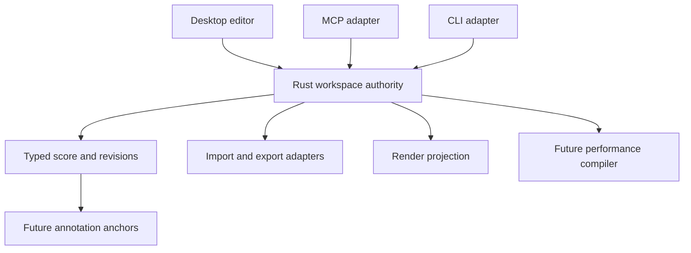

# ScoreStream 1.1 — English Design Document

**Proposed design baseline:** 2026-11-13. **Product:** Rust desktop score editor with live preview and a shared MCP service for agents.

This document combines the architecture, actual ScoreStream language standard, MCP contract, desktop editor/preview plan, future independent annotation model, Rust implementation milestones, and agent quick reference. The accompanying ZIP contains the EBNF, JSON format descriptor, AST and tool schemas, complete fixtures, and validation utilities. No PDF is provided.

**Delivery status:** design and contracts with finite package QA. No compiled Rust application, running desktop editor, converter, renderer integration, MCP server, annotation database, or playback engine is claimed. Annotation storage and playback are explicitly deferred. Relative file references refer to files inside the accompanying design package.

## Contents

- [System Design](#system-design)
- [ScoreStream Format Standard](#scorestream-format-standard)
- [Format Discovery and MCP Contract](#format-discovery-and-mcp-contract)
- [Desktop score editing, live preview, and future playback](#desktop-score-editing-live-preview-and-future-playback)
- [Future knowledge annotations and revision-bound anchors](#future-knowledge-annotations-and-revision-bound-anchors)
- [Rust implementation plan](#rust-implementation-plan)
- [ScoreStream 1.1 — Agent Reference](#scorestream-11-agent-reference)

---

## System Design

**ScoreStream 1.1 proposed design baseline — 2026-11-13**

### 1. Product decision

Build a **Rust score engine shared by a human desktop editor and an agent-facing MCP service**. Use a compact textual format, ScoreStream (`.sfs`), as the editable and model-facing representation. Keep a typed, revisioned score model behind that text. Provide an archival package (`.sfp`) when source preservation, mappings, and assets are needed.

The desktop client contains a notation canvas, text editor, selection and property editing, import/export, validation, and history. An AI can read and modify the same score through MCP, including individual notes and bounded passages. The first useful implementation should prove an end-to-end edit on a modest MusicXML score, render the result, and export a valid MusicXML score before attempting broad notation coverage.

The language is designed to grow without making ordinary music verbose. Basic events remain short; uncommon notation is carried by registered flat records and extensions. An explicit preservation layer retains source material that a particular adapter does not yet interpret. Preservation does not authorize a destructive edit to content whose semantics are unknown.

#### 1.1 Scope of this package

This is an implementation-ready design and contract package. It proposes syntax, typed operations, schemas, boundaries, tests, and milestones. It does not deliver the running software. “MUST” in the format and contract chapters describes conformance to this proposal, not an already established external standard.

The initial semantic profile is `core-measured`: a shared rational score-time axis, declared parts and voices, measured events, ordinary written pitch, common state and markings, and identified relationships. Unmeasured graphics, independent temporal clocks, and complete specialized notation vocabularies are explicitly outside this initial interpreted profile. Their sources must be preserved or the import must refuse an unsupported fidelity requirement.

### 2. What the format optimizes

The format serves four related tasks: humans inspecting or editing a passage, language models generating and understanding music, reliable adapters converting notation, and services making precise changes. Those tasks do not have identical needs. One small text syntax cannot replace a typed engine, a source archive, an engraving program, and a performance scheduler.

| Requirement | Design choice | Consequence |
|---|---|---|
| Simple text, little nesting | Line-oriented records with short prefixes | Common music is readable without a JSON tree |
| Simultaneous instruments together | One `@time` frame for all onsets at that score position | Vertical context is visible to the reader and model |
| Exact rhythm | Reduced rational quarter-note units | Tuplets do not accumulate floating-point timing drift |
| Correct notation exchange | Written pitch and written rhythm preserved separately from derived sound | Enharmonic spelling, accidentals, tuplets, and transposition remain distinguishable |
| Safe partial editing | Stable object identity, frozen selection, immutable revision, atomic commands | An agent cannot accidentally apply an old region to a changed score |
| Broad notation scope | Typed core plus versioned feature modules and preserved source attachments | Coverage is explicit and can grow without rewriting ordinary note syntax |
| Human application and agent service | One Rust authority with UI and MCP adapters | Both interfaces have the same behavior and history |
| Future descriptive knowledge | Separate annotation store with revision-aware musical anchors | Analytical prose does not pollute the score stream |

#### 2.1 Why spelling remains the authoritative pitch

`C#4` and `Db4` may refer to the same equal-tempered frequency while carrying different musical and written meanings. A numeric key number alone loses that distinction. ScoreStream therefore keeps a pitch as `(diatonic step, exact alteration, octave)`. This matches the distinction represented by MusicXML pitch data, while printed accidentals are separate notation data. [MusicXML pitch](https://www.w3.org/2021/06/musicxml40/musicxml-reference/elements/pitch/) · [Accidental](https://www.w3.org/2021/06/musicxml40/musicxml-reference/elements/accidental/)

Numeric forms are still valuable as **derived views**. A model can request written semitone coordinates, sounding semitone coordinates, intervals, scale degrees with a declared tonal reference, or pitch classes. For a conventional octave numbering, the written semitone coordinate is `12 × (octave + 1) + natural_step_offset + alteration`, with C offset 0. Fractions remain fractions for microtones. The spelling remains available alongside the derived number; a numerical projection must not silently become the reversible master representation.

#### 2.2 Why onsets, rather than every sustained sound, are stored

Each event appears at its onset and carries its duration. At time 2, a bass note begun at time 0 may still be active even if its voice has no row at time 2. Reprinting every sustained note at every frame would increase text size, complicate identity, and make partial edits harder.

Offer distinct views named `onsets`, `active_score`, and later `sounding_performance`. The first is the canonical event stream. The second derives intervals covering a score position. The third incorporates repeats, ties, ornaments, transposition, and performance policy. These views answer different musical questions and must never be confused.

### 3. Architecture



The workspace authority owns document identity, revisions, commands, validation, persistence, and jobs. It accepts typed requests from all adapters. Neither MCP nor the GUI writes score tables directly. The renderer is replaceable; it receives a derived notation document and returns layout output plus identity mapping.

The proposed desktop shell is **Tauri 2**. Rust owns the domain, storage, application services, and MCP integration; a TypeScript WebView supplies the editor and SVG interaction. Tauri documents this split between a Rust core process and WebView processes, and offers commands/channels between them. This is a Rust product architecture with a web-based view layer, not a promise of an all-Rust GUI. [Tauri architecture](https://v2.tauri.app/concept/architecture/) · [Process model](https://v2.tauri.app/concept/process-model/) · [Calling Rust](https://v2.tauri.app/develop/calling-rust/)

#### 3.1 One authority per workspace

The desktop application embeds the authority. A local stdio MCP executable acts as an IPC bridge to it. A headless mode may run that authority when the desktop is absent, but only after acquiring exclusive workspace ownership. An optional loopback HTTP MCP adapter connects to the same authority.

Do not run two writable caches of the same score merely because one client is a human and the other is an agent. Workspace discovery, owner lifetime, and recovery after a crashed owner are part of the application layer. A process lock alone is insufficient if persistence transactions and crash recovery can still publish inconsistent heads; the storage design must make the commit boundary durable.

#### 3.2 Internal domain model

The Rust score model should have typed IDs and explicit types for score time, duration, pitch, staff, voice, measure, state assignment, point mark, and relationship. Event collections are indexed by onset and object identity. Relationships are graph edges with typed endpoints, not anonymous start/stop counters that depend on traversal order.

Flat interchange does not imply flat implementation. A renderer, conversion adapter, selection resolver, or edit validator needs typed musical semantics. JSON is an auxiliary API representation, not the canonical in-memory model. Source token spans and preserved XML are separate attachments to domain objects.

Use exact arbitrary-precision rational arithmetic in the canonical timing layer. A fixed-width fast path is an optimization only when checked overflow can fall back safely. Resource limits remain necessary for adversarial or impractically large numerators, denominators, and least common multiples. Time-to-pixel and time-to-sample conversions occur at explicit boundary layers.

### 4. Documents, packages, and persistence

#### 4.1 Plain score text

An `.sfs` file is UTF-8 ScoreStream text. It contains score notation and intrinsic text such as lyrics, directions, titles, and harmony labels. It does not contain a knowledge essay, embeddings, application credentials, renderer output, or audio samples.

For everyday authoring, event IDs may be omitted. A successful import or commit assigns stable internal identities and returns a text-ID mapping. Canonical editor and agent reads include IDs. External opaque API IDs do not have to satisfy the stricter text identifier grammar; adapters map them explicitly.

#### 4.2 Archival package

An `.sfp` package is a proposed ZIP-based interchange container. Its manifest references:

- canonical `score.sfs` and its format/profile version;
- immutable original source assets, each with format, media type, hash, and provenance;
- source-to-score identity mappings;
- preserved unsupported payloads, their anchors, and their validity status;
- required notation extensions and any assets needed to interpret them;
- a conversion/fidelity report.

The package must never make an unknown source attachment executable. Paths must be relative and constrained to the package; asset hashes are verified. A final binary package layout and schema should be frozen during the import/export milestone after real fixture requirements are known. The design package delivered here is a ZIP of design materials, **not an `.sfp` score archive**.

#### 4.3 Local storage

Use a local transactional store for score metadata, immutable revisions, object/region indexes, change events, and idempotency receipts. Store large original sources, render artifacts, and exports by content hash. SQLite is a reasonable initial implementation choice; logical schema and transactional behavior are more important than that choice.

One commit creates a new revision, stores its operation/result mapping, updates the score head, and persists the idempotency receipt atomically. It then publishes a change event. Undo produces a new revision describing an inverse or restored snapshot; it does not silently move a shared head behind an agent's back. Retention and pruning must respect pinned revisions and archival provenance.

The future analytical knowledge store is physically independent. The score database must open and operate when that store is absent. No foreign key or startup dependency should require an annotation service to be online.

### 5. Interoperability and fidelity

#### 5.1 Three different promises

| Promise | Meaning | Test |
|---|---|---|
| Source-byte recovery | The untouched original file can be retrieved exactly | Compare original bytes/hash |
| Musical semantic round-trip | Supported musical properties survive conversion | Compare typed normalized properties and source-to-first-model assertions |
| Engraving equivalence | Relevant layout and glyph decisions survive acceptably | Compare explicit engraving properties and reviewed renderer output |

An untouched source may be recovered from the archive even when the renderer cannot interpret every element. That does not make an edited export semantically lossless. After an edit, preserved payloads affected by the change may become stale. The v1.1 export policies are explicit: `strict` refuses any unsupported required meaning, while `allow_reported_loss` permits a documented lossy projection. Both policies retain only attachments whose validity has been established; the report identifies stale or unsupported attachments. Original-byte recovery is a separate archival function, not a third export fidelity policy.

#### 5.2 MusicXML import

Import must understand MusicXML temporal instructions rather than treating XML child order as a global timeline. Resolve each part's measure context, divisions, cursor movement through `backup`/`forward`, simultaneous chord members, voice and staff assignment, and actual event times. Merge resolved onsets across parts into ScoreStream frames. Keep display measure numbers separate from stable measure identity.

MusicXML divisions values are decimal values in the relevant type, not an assumption that every source uses a fixed integer PPQ. Parse finite decimals exactly into rationals. Also preserve written type, dots, time modification, normal type/dots, accidentals, transposition, note visibility, and imported relations. The actual note duration and written notation are distinct source facts; inconsistent source notation should produce a diagnostic rather than a silent “correction.” [MusicXML divisions](https://www.w3.org/2021/06/musicxml40/musicxml-reference/data-types/divisions/) · [Time modification](https://www.w3.org/2021/06/musicxml40/musicxml-reference/elements/time-modification/)

The first adapter milestone should explicitly cover partwise/timewise input, compressed `.mxl` containers, pickup measures, multiple voices, piano staffs, chord ordering, ties/slurs, tuplets, and printed text. Each feature has its own test fixtures and support status. Reading arbitrary XML into a generic blob does not satisfy those semantic gates.

#### 5.3 MusicXML export

Export traverses the typed score into legal part/staff/voice serialization, choosing divisions to represent the time rationals exactly when feasible. It inserts required cursor movement and preserves the distinction between sounding ties and printed tied marks. Where a chord structure is not directly legal in the target representation, the exporter must use a documented legal projection, such as explicit voices, or reject the requested fidelity policy.

A denominator strategy for time does not solve every rational representation problem. MusicXML's semitone type is decimal. A ScoreStream alteration of `1/3` semitone cannot be represented exactly as a finite decimal in that field. A target adapter must report this limitation, use a supported target extension if available, or reject strict export. It must not silently round and call the result exact. [MusicXML semitones](https://www.w3.org/2021/06/musicxml40/musicxml-reference/data-types/semitones/)

#### 5.4 Required coverage matrix

Maintain a versioned coverage matrix with independent columns for **parse**, **interpret**, **edit**, **export**, **render**, and **perform**. Suggested feature families are:

| Family | Examples to track separately |
|---|---|
| Time and measures | Pickup, additive meter, hidden/irregular measures, tuplets, independent clocks, unmeasured passages |
| Pitch and instruments | Enharmonic spelling, microtones, transposition, octave signs, instrument changes, percussion, tablature |
| Event notation | Rests/spacers, grace/cue notes, noteheads, stems, beams/hooks, tremolos, articulations, ornaments |
| Relationships | Ties, slurs, tuplets, wedges, pedals, lyric extension, cross-staff links |
| Navigation | Repeats, endings, segno/coda, D.C./D.S., fine, playback-only conditions |
| Text and layout | Lyrics, harmony, directions, typography, page/system breaks, staff groups, graphic placement |
| Source extensions | Vendor-specific XML, unknown notation, external glyph/assets |

Core syntax covers common primitives, while extension registries and source attachments cover growth and preservation. Support is not inherited from a neighboring feature: the ability to draw a repeat barline does not prove correct repeat playback.

### 6. Human editing and agent editing

The desktop should present a score list/project view, synchronized SFS editor and notation canvas, properties for selected objects, diagnostics, and history. Source selection highlights the score; clicking a note identifies its stable event and source span. A rectangle is a temporary UI gesture that must be resolved through a revision-specific render map into a musical selection.

Use the same application commands for text commits, pitch/duration edits, note entry, graphical property edits, and MCP operations. The v1.1 region operation preserves the replaced duration and rejects unresolved crossing relationships. Ripple edits, arbitrary measure restructuring, and automatic polyphonic recomposition are later explicit commands, not hidden side effects of replacement.

A dirty text buffer is an uncommitted human draft. If an agent commits while it is dirty, retain that draft and its base revision. The desktop presents the new persisted head and enables reconciliation. Never replace the draft with the agent's version automatically. If the buffer is clean, it may follow the committed head while retaining cursor/selection where IDs still resolve.

#### 6.1 Selection and transaction model

The read API resolves a selector against an exact revision and returns a frozen selection, its digest, and boundary context. The edit request names `expected_revision_id`, that frozen selection, typed operations, and an `idempotency_key`. The core validates the full proposed change and commits it atomically using compare-and-swap on the head.

IDs are not enough on their own: a selection of event IDs can still be musically invalid if a tie, tuplet, lyric extension, or sustained note crosses its boundary. Context must include those dependencies. The command may explicitly remove or retarget supported relations, including references to newly inserted fragment events in the same transaction. Unresolved dependencies fail the entire command.

### 7. Preview and later performance

For the desktop prototype, project the score to a renderer-specific representation and use a WebView worker to render SVG. Verovio is the proposed first backend, with a capability and licensing review at implementation time. Preserve score event/measure IDs through the projection and map them to SVG groups. Verovio documents identity mappings and also documents that unsupported MEI content may be discarded during processing; therefore its imported/exported model cannot be the authoritative archive. [Verovio internal structure](https://book.verovio.org/advanced-topics/internal-structure.html) · [Input formats](https://book.verovio.org/toolkit-reference/input-formats.html)

Start with debounced full layout, cancellable or replaceable pending jobs, revision-keyed cache entries, and stale-result rejection. Live desktop preview also covers valid uncommitted text: the editor creates an ephemeral draft snapshot after validation, keyed by session, draft sequence, content hash, and base revision. Invalid text retains the last good view with an out-of-date indicator. This private draft path creates no committed revision and does not change MCP's committed-score reads or its pure edit-diff preview tool.

Incremental parsing, partial score requests, partial SVG delivery, and true incremental engraving are different capabilities. Only the last requires the renderer to preserve global layout correctness after a local edit. Do not promise it before measurement and backend support.

Playback is a future layer. Compile score order into performance occurrences, expand navigation under a bounded policy, construct tempo and expression curves, then map musical time to wall-clock/sample time. Keep written pitch, sounding pitch, MIDI/render events, and audio distinct. MCP can later issue high-level transport commands but must not become the real-time scheduler or audio callback path.

### 8. Future AI generation and knowledge retrieval

A generator should produce bounded candidates in the declared format/profile. Validate lexical structure, references, timing, supported notation, and requested musical constraints before committing. A model's output is a proposed edit, even when it is syntactically valid. Keep model provenance and sampling settings outside the score's musical data unless intentionally authored as score metadata.

For training or retrieval, derive views from the same typed score: onset windows, active vertical harmonies, melodic intervals, harmonic rhythm, instrument/voice roles, and later performance features. Do not create mutually inconsistent authoritative representations for each model. Windows must carry entry state, continuing notes, and crossing relations so a mid-phrase example is interpretable.

Knowledge annotations can describe that a passage increases tension, changes orchestration, or establishes a rhythmic character. Their claims, region anchors, authorship, confidence, and evidence belong to the independent future store. An embedding is a derived index for retrieval, not the canonical annotation text or its identity. Re-embedding must not change the underlying annotation record.

Evaluation should separate syntax validity, musical constraint satisfaction, conversion fidelity, edit locality, and subjective musical quality. When a future training corpus includes variants of the same composition, split at a work/family level to reduce leakage across versions. Source rights and provenance remain corpus metadata; this package includes only original small fixtures.

### 9. Implementation acceptance criteria

The detailed milestones are in the implementation-plan chapter. The first integrated release should demonstrate:

1. A desktop user imports a supported MusicXML fixture, sees SFS and notation, edits a note, and exports the intended result.
2. An agent retrieves the format reference without prior knowledge, reads a passage, replaces it, and receives a revision-bound result.
3. A stale human or agent request conflicts without a partial commit; retrying an identical accepted request does not duplicate it.
4. A render completing for an old revision cannot overwrite the current preview.
5. Unsupported source material remains visible in a coverage report; strict export never silently drops it.
6. An absent annotation database and absent audio engine do not prevent core editing.

Use source-to-first-model golden assertions as well as round-trip tests. If import loses a property and export faithfully reproduces that already-damaged model, a round-trip-only test can miss the loss. Include property tests for rational operations, serialization determinism, identity mappings, edit locality, and transaction invariants where those tests target real failure modes.

Performance targets should be measured on declared fixtures and hardware, with parse, validate, commit, render, and UI latency recorded separately. Numbers in a roadmap are targets, not achieved benchmarks. Freeze product defaults only after representative scores, large orchestral scores, and difficult notation cases have been measured.

---

## ScoreStream Format Standard

**Proposed version:** 1.1. **Initial semantic profile:** `core-measured`. **File extension:** `.sfs`. **Encoding:** UTF-8. **Time unit:** quarter note = 1.

This chapter is normative within this design proposal. The EBNF specifies text structure; the language descriptor specifies machine-readable rules and vocabulary; the AST schema specifies the parsed JSON representation. A conforming implementation needs all three layers. The package QA utility covers the supplied fixtures and a stated subset of these semantics; it is not the production parser.

### 1. Model and notation

A score consists of declarations followed by increasing shared-time frames. All events beginning at one time are written vertically within the same frame, regardless of instrument. An event's duration is explicit. Missing rows do not represent rests. A dot on its own line closes the frame.

```text
!score 1.1 unit=q
!part p instrument=piano staves=2
!part v instrument=violin staves=1
!voice pr part=p staff=1
!voice pl part=p staff=2
!voice vn part=v staff=1
@0
= score tempo=q:120
= p.s1 meter=4/4 key=0 clef=G2
= p.s2 meter=4/4 key=0 clef=F4
= v.s1 meter=4/4 key=0 clef=G2
| p pm1 len=4 label="1"
| v vm1 len=4 label="1"
pr C4:1 id=n1 chord=c1
pr E4:1 id=n2 chord=c1
pr G4:1 id=n3 chord=c1
pl C3:4 id=n4
vn C5:2 id=n5
.
@1
pr D4:1 id=n6 chord=c2
pr F4:1 id=n7 chord=c2
pr A4:1 id=n8 chord=c2
.
@2
pr E4:2 id=n9 chord=c3
pr G4:2 id=n10 chord=c3
pr B4:2 id=n11 chord=c3
vn D5:2 id=n12
.
!end at=4
```

The bass `n4` spans `[0,4)`. It remains active at frames 1 and 2 without being repeated. At frame 0, three piano chord members, the bass event, and the violin event start simultaneously. This is temporal alignment, not a fixed-width table with an empty column for every instrument.

### 2. Lexical rules

The grammar is `spec/scorestream.ebnf`. Readers accept LF and may normalize CRLF to LF. Canonical writers emit LF, one space between fields, no trailing whitespace, and a final newline. Whitespace inside a quoted string is content. Numeric formatting is locale-independent.

| Element | Syntax and rule |
|---|---|
| Text identifier | ASCII letter followed by ASCII letters, digits, `_`, or `-` |
| Exact rational | Integer or `numerator/denominator`; denominator positive; canonical fraction reduced |
| Positive duration | Strictly positive rational, for example `1`, `1/2`, `3/2` |
| Quoted string | JSON string escaping, such as `text="dolce"`; physical newlines inside a token are forbidden |
| Atom | Unquoted token without whitespace, quotes, or control characters |
| Boolean | `true` or `false`, only where a field is registered as boolean |
| Event reference | `#` followed by a text event identifier |
| Comment | Whole line beginning with `;` after optional whitespace |
| Attribute | `name=value`; duplicate names in the same record are invalid |

There are no inline comments. In particular, `#` is part of pitches and event references. A parser must use a lexer that respects quoted strings; splitting on spaces or `#` is insufficient. JSON strings must decode to valid Unicode scalar values, including correct surrogate-pair handling.

The registry determines an attribute's type. `w=4` has a note-type token, `staff=2` has an integer, and `text="4"` has a string. Do not globally guess types from token spelling. Rational values remain strings in JSON AST/API representations so that clients do not round them through floating-point numbers.

Timing values such as `2/4`, `0/3`, and `-0` are not canonical. Canonical forms are `1/2` and `0`. Readers may accept unreduced lexical fractions only in a normalization mode that reports the normalization; strict conformance validates reduced form. A slash denominator of zero and a negative measured duration are errors.

### 3. Headers, declarations, and identity

| Record | Meaning |
|---|---|
| `!score 1.1 unit=q` | Start a complete score |
| `!part p instrument=piano staves=2` | Declare part alias, instrument key, and staff count |
| `!voice pr part=p staff=1` | Declare stable voice alias and its initial display staff |
| `!meta title="Example" composer="Example Author"` | Intrinsic score metadata |
| `!requires vendor.feature@1` | Require a versioned semantic extension |
| `!end at=4` | Close the document at a declared score position |

Declarations occur before frames. A voice's part must exist; its staff number is one-based and must be within that part. A complete core score must contain at least one declared part and voice when it contains events. Empty documents may be used only if the application explicitly supports an empty-score state.

Part and voice aliases must be disjoint. `score` is reserved and cannot be either. Unsuffixed scope tokens are therefore unambiguous. Staff scope `p.s2` means staff 2 of part `p`; it is not a voice alias and not a persistent external staff ID.

Event IDs are unique across the score's event namespace; measure IDs are unique across its measure namespace; relation IDs are unique across its relation namespace; chord IDs are unique across its chord namespace. References are typed by their field. A relation ID cannot be reused for another relation kind. A chord ID denotes one attack group, not every recurrence of a harmony.

External object IDs returned by the API are opaque. The application may use UUIDs or another representation that is not a legal text token. It must return and preserve mappings between external IDs and SFS text IDs/aliases. Agents must use those mappings rather than copying an arbitrary external ID into source text.

Authoring a new complete score may omit event IDs. Import assigns them and returns canonical text with IDs. Canonical reads and bounded edit fragments carry IDs. Original source IDs are provenance values and must not be confused with newly assigned ScoreStream identities.

`instrument` is a symbolic instrument identity or catalog key. It is not an implicit MIDI program, transposition, tuning, staff type, or percussion map. Those properties must be explicitly represented in supported domain fields/extensions. No convention silently turns `clarinet` into a B-flat transposition.

Core metadata fields are string-valued `title`, `subtitle`, `composer`, `lyricist`, `arranger`, `work_number`, `movement`, `movement_number`, `rights`, `source_description`, and `language`. More than one attribution or a richer source catalog requires a registered metadata extension. Analytical prose is not score metadata.

### 4. Frames and stream completion

A frame starts with `@` followed immediately by a nonnegative rational score position. Core frame positions strictly increase. All records at equal time belong to a single frame. The first frame may start after zero, but that does not create implicit rests before it.

Within a frame, records are collected before reference resolution. State assignments apply at that position independent of whether their text line precedes a note. Conflicting assignments to the same state property and scope at the same time are errors. Input event order is retained for chord-member and grace-group ordering; a writer must not sort those members by pitch and destroy their order.

The closing `.` is the parser's frame boundary. It allows an incremental parser to publish a complete frame. It is **not** a durable database commit or permission to display half of a user transaction. An incomplete frame at EOF is an incomplete draft and cannot be committed. The explicit `!end` closes a complete document and checks that the declared end is no earlier than all measured event tails and measure ends.

A streaming application can validate completed frames incrementally, while retaining unresolved forward references until the required boundary. A replacement operation or full-score import commits only after its complete document, required context, and semantic validation succeed. User-facing previews distinguish incomplete drafts from committed revisions.

Canonical writers use a deterministic order: declarations in stable part/voice order; frames by rational time; measure records; scoped state records; events in declared voice order while retaining chord/grace order; point marks; relation records. Relations and event-attached marks are resolved using identities, not their position in that textual ordering.

### 5. Events, pitch, rests, and duration

The basic event record is:

```text
voice pitch:duration [attribute=value ...]
```

| Example | Meaning |
|---|---|
| `vn C4:1 id=n1` | Written middle C, one quarter-note unit |
| `vn C#4:1/2 id=n2` | C-sharp in octave 4, half a quarter unit |
| `vn Db4:1/2 id=n3` | D-flat, preserving different spelling |
| `vn C(+1/2)4:1 id=n4` | C raised by half a semitone |
| `vn F(-1/3)5:1 id=n5` | Exact third-semitone lowering |
| `vn r:1 id=r1` | A notated rest |
| `vn _:1 id=s1` | An invisible temporal spacer |
| `dr u.snare:1 id=d1` | Unpitched event using a declared/known percussion identity |

Written pitch is `(step, alteration, octave)`. Plain accidentals include `#`, `##`, `b`, and `bb`. The parenthesized exact alteration supports microtones beyond those abbreviations. An omitted alteration is zero. Canonical writers prefer ordinary accidental spellings for integral changes of one or two semitones, and use parentheses for other changes. Signed octaves are permitted; range limits belong to a target capability profile, not an implicit MIDI clamp.

A numeric pitch projection is derived and must declare whether it is written or sounding pitch. It does not replace the written spelling. A printed courtesy accidental is attached separately, for example:

```text
+ #n2 accidental value=sharp visible=true cautionary=true
```

That mark does not change `n2`'s pitch. If an edit changes pitch, its accidental policy must either preserve a still-consistent mark or recompute it using notation context. Silent divergence between pitch and a printed glyph is not acceptable.

Ordinary notes, cue notes, rests, and spacers have strictly positive measured duration. The interval of an event at `t` with duration `d` is `[t,t+d)`. Grace events have `?` duration and their own rules below. An absent voice row means no new event; it does not mean a rest, tie, silence, or a repeated note.

Common event attributes also include boolean `visible` (default true), `stem=up|down|none|double`, and `notehead=normal|x|diamond|triangle|slash|none`. Other notehead glyphs need a registered extension. `slash` is boolean and applies to grace notation. Hidden events retain their musical identity and duration.

#### 5.1 Written rhythm

| Field | Type | Meaning |
|---|---|---|
| `w` | Note-type token | Written note type: `1`, `2`, `4`, `8`, through `1024`, or `breve`, `long`, `maxima` |
| `dots` | Nonnegative integer | Written augmentation dots; default 0 |
| `tm` | Positive integer pair | Actual:normal time modification, such as `3:2` |
| `tm_normal_type` | Note-type token | Explicit normal note type in a time modification |
| `tm_normal_dots` | Nonnegative integer | Explicit normal augmentation dots in a time modification |

`tm_normal_type` and `tm_normal_dots` require `tm`. They map to `written.time_modification.normal_type` and `.normal_dots` in typed edit operations. A visible tuplet bracket and number are a relation, separate from these per-note values.

For an ordinary written eighth-note triplet with default normal notation, `w=8 tm=3:2` corresponds to `(4/8) × (2/3) = 1/3` quarter units. Written dots multiply the undotted value by `2 - 1/2^dots`. Explicit normal notation must also be retained and interpreted according to its feature semantics; do not discard it merely because a simple ratio seems sufficient.

Actual measured duration remains authoritative for score time. Imported written fields and measured duration may disagree. Preserve both and emit a diagnostic; do not silently rewrite the source. An omitted `w` means unspecified spelling. A renderer/exporter may choose a documented spelling and report that inference, but cannot claim imported engraving fidelity for a spelling that was never supplied.

#### 5.2 Chords and voice identity

Use a shared `chord` ID on simultaneous notes in one voice. Chord members must have the same onset and voice, but may have different durations. Their source/member order is retained; the first member is the serialized head. A target adapter applies its own representability constraints and reports any projection. A group cannot mix ordinary notes with rests or spacers.

Different voices that start together are separate voices unless explicitly grouped by a supported notation relationship. Do not turn vertical simultaneity into an arbitrary chord. One voice may contain successive attacks while an earlier chord member still sustains; active-note queries use intervals rather than assuming a single active event per voice.

Voice identity is independent of display staff. `staff=2` changes only the event's display staff within its part. It does not rename the voice or change later events. `= pr staff=2` changes that voice's default staff from the frame position onward. The default and event override are explicit different mechanisms.

#### 5.3 Grace and cue events

```text
pr D5:? id=g1 kind=grace anchor=#a order=-1 w=8 slash=true
pr C5:2 id=a w=2
```

The grace event and its principal anchor occur in the same score-time frame. Its order is nonzero: negative values precede the principal and positive values follow it in the grace ordering. Ordering values are unique per anchor attack group; members of an explicit grace chord may share the group's order. Grace notation consumes no measured score duration. Allocation of performed time belongs to a later performance policy.

Grace anchors must resolve to an appropriate non-grace event. Grace chains, rest anchors, or unspecified ordering are rejected unless a declared extension defines their semantics. A slash is a printed grace attribute, not a universal instruction to shorten the note by a fixed number of milliseconds.

`kind=cue` marks a measured cue event. Its printed size and eventual performance policy must be kept distinct; the core does not silently route every cue note to playback. The ordinary event kind is `note` when omitted for pitched/unpitched events.

### 6. State and measures

State records use `= scope field=value ...`. They persist until changed at that same semantic scope. Omission leaves state unchanged; initially unspecified fields remain unset. There is no universal score-to-part-to-staff inheritance system.

| State | Allowed scope | Core value |
|---|---|---|
| `tempo` | `score` | Beat token and positive rational rate, such as `q:120` or `q.:60` |
| `meter` | Staff | `4/4`, `6/8`, additive `3+2/8`, or `none` |
| `key` | Staff | Signed fifths count or `unset` |
| `clef` | Staff | Common G/F/C line token, `percussion`, or `TAB` |
| `staff` | Voice | One-based default staff number within the voice's part |
| `instrument` | Part | Explicit instrument identity |
| `transpose_chromatic` | Part or staff | Exact chromatic written-to-sounding interval |
| `transpose_diatonic` | Part or staff | Diatonic interval as integer |
| `transpose_octaves` | Part or staff | Additional octave displacement as integer |

Transposition is a tuple. When assigned, all three fields must be present; zero is explicit. A staff tuple overrides the part tuple as a whole; if absent, the part tuple applies. Missing part transposition means zero. This is a specific musical rule, not generic scope inheritance. Clef octave displacements, specialized tunings, and richer transposition models require a registered extension until explicitly standardized.

Core tempo beat tokens are `w`, `h`, `q`, `e`, and `s`, optionally dotted. They mean whole, half, quarter, eighth, and sixteenth note respectively. The rate is beats per minute of that unit. Thus `q.:60` is 60 dotted quarters per minute. Printed metronome text is a separate mark; performance tempo curves and metric modulation need declared semantics beyond a scalar assignment.

Core clefs permit G on lines 1–2, F on lines 3–5, C on lines 1–5, `percussion`, and `TAB`. Meter `none` removes a conventional signature; it does not make measured duration disappear or introduce an independent clock. More complex mixed signatures and genuinely unmeasured notation require a feature module.

A measure record has the form:

```text
| p pm1 len=4 label="1"
```

Its start is the frame position; `len` is actual elapsed score duration. `label` is a display string, not identity. `implicit=true` can identify a pickup/implicit measure. The target is a part or a staff; `score` and voice targets are invalid for measures. A part measure applies to that part's staffs. If staff-local measures are used for a polymetric profile, the same staff must not have conflicting overlapping part/staff measure ownership.

Meter and actual measure length are separate. A pickup may have `len=1` under `4/4`. A core measured profile uses the one global rational clock even when parts have different measure boundaries. Independent free-running local clocks are a future extension. Imported empty, irregular, hidden, or non-controlling measures require explicit coverage checks; do not force every measure to equal the displayed time signature.

### 7. Intrinsic marks and relationships

A point mark uses `+ target kind attributes`. The target is an event reference or an allowed musical scope. Event-attached marks appear in the anchor's onset frame. Scope-attached marks occur at the current frame time. Optional `id` gives a stable mark identity in canonical text; committed reads must preserve the application's mark mapping.

| Kind | Principal fields | Allowed targets |
|---|---|---|
| `accidental` | `value`, `visible`, `cautionary`, `parentheses`, `editorial` | Pitched event |
| `articulation` | `value`, `placement` | Event |
| `dynamic` | `value`, `placement` | Scope or event |
| `lyric` | `verse`, `text`, `syllabic`, `language` | Event |
| `words` | `text`, `placement`, `language` | Scope or event |
| `metronome` | `beat`, `bpm`, `text` | Scope or event |
| `harmony` | `root`, `kind`, `bass`, `text` | Scope or event |

Text fields are strings. `verse` is a positive integer. Boolean fields use boolean tokens. `placement` is `above` or `below`. `syllabic` is `single`, `begin`, `middle`, or `end`. Core accidental values are `natural`, `sharp`, `flat`, `double-sharp`, `flat-flat`, `quarter-sharp`, and `quarter-flat`; other glyphs require a registered vocabulary. Core articulations include `staccato`, `staccatissimo`, `tenuto`, `accent`, `strong-accent`, and `breath-mark`. Dynamic values include ordinary `pppp` through `ffff`, `mp`, `mf`, `sfz`, and `fp`; special text can be an explicit `words` mark without pretending to have defined performance semantics.

Harmony roots/basses are spelled pitch classes. The initial harmony vocabulary includes `major`, `minor`, `dominant`, `major-seventh`, `minor-seventh`, `diminished`, and `augmented`. Complex chord degrees, figured bass, and alternative systems require a richer registered module. A text label can be retained without being claimed as interpreted harmony.

Relationships use an explicit ID and event anchors:

```text
~ tie t1 start=#a sound=true print=true
~ tie t1 end=#b
```

| Kind | Important attributes | Span meaning |
|---|---|---|
| `tie` | `sound`, `print`, `placement` | Link distinct written notes with validated sounding continuity |
| `slur` | `placement`, `line_type` | Explicit start and final event; crossing slurs allowed |
| `tuplet` | `actual`, `normal`, `bracket`, `show_number` | Written group ending with its final member |
| `beam` | `level` | Ordered written members; hooks need an explicit feature module |
| `crescendo`, `diminuendo` | `placement` | Notated wedge span; expression realization is separate |
| `pedal` | `value`, `line`, `sign` | Identified pedal span with explicit continuation points |
| `octave` | `octaves`, `print`, `sound` | Explicit notated/sounding octave displacement |
| `lyric_extend` | `verse` | Melisma/lyric extension with explicit end |

Each closed core relation has one start, one end, and zero or more ordered continuations. The record occurs at the anchor's frame. The relation's type is stable. Attributes that define the relation belong on its start; repeated immutable attributes must agree. Pedal control values at continuations are per-anchor values. References are resolved after frame collection. No stack nesting assumption is allowed, because musical relationships can cross.

Core tie defaults are `sound=true` and `print=true`; an importer must supply explicit differing values when source sounding and printed ties differ. A sounding tie requires compatible sounding pitch and end/start continuity under the declared profile. Notation-only ties can set `sound=false`. A tie is not a single merged note: retaining separate note identities preserves barline spelling and editing targets.

Tuplet `actual` and `normal` are positive integers; start requires both. `bracket` is boolean, and `show_number` is `actual`, `both`, or `none`. Beam `level` is a positive integer. Octave `octaves` is a nonzero integer; `print` and `sound` are booleans. Pedal `value` is an exact rational from 0 through 1; `line` and `sign` are booleans. Slur `line_type` is `solid`, `dashed`, or `dotted`. These basic fields are a declared initial vocabulary, not a claim that all source-specific variants are already standardized.

An extracted region may have crossing relations. It must carry boundary context separately rather than presenting dangling relation records as a complete standalone score. A complete score cannot silently leave open ties, tuplets, or other required endpoints.

### 8. Bounded fragments and partial edits

A replacement fragment uses local time and explicit length:

```text
!fragment 1.1 unit=q span=4
@0
mel C5:1 id=f1
.
@1
mel D5:1 id=f2
.
@2
mel E5:2 id=f3
.
!end at=4
```

The edit request binds `mel` to an existing voice ID. Fragment event IDs are local to that insertion and map to returned stable IDs after commit. The header does not declare new parts or voices. A fragment has `end=span`, all measured onsets in `[0,span)`, and event tails within the span. The core replacement profile requires coverage of each declared replacement voice interval using notes, rests, or explicit spacers. Chord member overlaps do not count as separate elapsed time.

Fragments inherit declared entry context from the frozen selection. They cannot change global state or measure objects in v1.1. They cannot introduce new required extensions. Their internal event references resolve locally; reconnection to external relationships uses typed transaction operations. This keeps a fragment small while preserving a well-defined boundary.

`replace_range` uses `duration_policy="preserve"` and `boundary_policy="reject_unresolved_crossings"`. The span length must equal the replaced interval. A voice binding must refer to an authorized voice within the resolved selection. Unselected voices remain untouched. Ripple replacement is not a v1.1 option.

The typed edit schema also defines `set_pitch`, `set_duration`, `move_event`, `delete_events`, `remove_relation`, and `retarget_relation`. Exact fields are in `schemas/edit.schema.json`. A retarget operation can name a fragment event by operation index and local ID, allowing a crossing relationship to be repaired within the same atomic command. Referencing an uncommitted guessed global ID is not supported.

Every edit identifies `score_id`, `expected_revision_id`, a frozen selection reference, and `idempotency_key`. A successful command returns a new revision, mappings, impacts, and diagnostics. A conflict does not reevaluate the selector on the latest revision automatically. The agent must read the current score and form a new valid request.

### 9. Extension and preservation rules

Unknown unqualified attributes or kinds are errors. A semantic extension has a versioned namespace, declared with `!requires`. Namespaced attributes use `x.namespace.field`; namespaced mark and relation kinds use `namespace.kind`. Extension registries specify their own fields, targets, meaning, validation, canonicalization, and conversion behavior.

An implementation that does not understand a mandatory extension can preserve and inspect the document if its preservation path is safe. It must not claim semantic support or perform operations that require interpreting that extension. Core operations unaffected by a preserved attachment require an explicit impact/validity decision; “unknown” is not automatically “safe to keep after any edit.”

New record prefixes require a grammar/version change or an explicit transport contract. They cannot be smuggled into a core parser as arbitrary ignored lines. Independent clocks, arbitrary graphic notation, navigation execution, special instrument systems, and detailed engraving are planned feature families; their appearance in a roadmap does not make their syntax implemented.

Complete source recovery uses the archival package with original bytes and attachment mappings. A plain `.sfs` file containing only interpreted core events is not a byte-identical backup of arbitrary MusicXML. If a source feature cannot be interpreted or safely preserved, import/export must report or reject it under the selected fidelity policy.

### 10. Canonicalization and compatibility

Canonicalization preserves musical semantics, object identities, chord/grace ordering, and declared notation fields. It reduces rational values, emits stable field/record order, and assigns IDs when necessary. It does not rewrite enharmonic spelling, quantize rhythms, merge ties, fill every gap with rests, or regenerate authored lyrics.

Text comments and formatting can be retained in an editor concrete syntax tree. They are not musical knowledge annotations and are not required semantic contents of the normalized AST. A source-preserving edit can keep trivia when practical; a canonical export may normalize it. Original source recovery remains an archival function.

An implementation must reject an unsupported major/minor format version unless it has an explicit compatible reader. The output reports the exact version and profile it produced. Application capability reports are independent from format version: two conforming parsers can have different renderer or target-export support.

### 11. Validation layers

| Layer | Responsibility | Example failure |
|---|---|---|
| Lexer/parser | EBNF and token formation | Unclosed quote, malformed pitch, missing frame dot |
| AST schema | Structural shape and primitive constraints | Wrong record type, absent field, JSON float used for time |
| Language semantics | Identity, references, time, scopes, groups, extension rules | Unknown voice, duplicate ID, frame order error, invalid grace anchor |
| Edit semantics | Frozen revision, interval coverage, authorized bindings, crossing relations | Replacement too long, stale selection, dangling tie |
| Adapter capability | Source/target fidelity and feature support | Nonterminating alteration cannot be represented exactly in a target field |
| Product integration | Durable commits, UI state, rendering, playback | Old render displayed over a newer revision |

The `S001`–`S018` rules in the language descriptor summarize essential semantics. A JSON Schema pass is necessary for an AST-based API, but it does not prove those rules or musical quality. Diagnostics should carry stable lowercase codes, severity, source range/object IDs, concise explanation, and a recovery suggestion when one exists.

### 12. Agent discovery contract

`score_get_format({})` selects the current supported format/profile and returns a practical quick reference inline. The response includes record syntax, exact time/pitch rules, defaults, semantic constraints, complete examples, and versioned resources. More detailed selection returns the full descriptor. The agent does not need to infer the DSL from MCP input-schema property names.

Resources include:

- `scorestream://spec/1.1/agent-reference`
- `scorestream://spec/1.1/grammar`
- `scorestream://spec/1.1/language`
- `scorestream://spec/1.1/ast-schema`

The primary format artifacts are `spec/scorestream.ebnf`, `spec/scorestream-language.json`, `schemas/scorestream-ast.schema.json`, this chapter, and the complete fixtures. If an artifact conflicts with another, the package must be corrected before a format release. The runtime must not silently invent a precedence rule to hide a contract inconsistency.

---

## Format Discovery and MCP Contract

**Status:** design only. This package does not contain a running MCP server. The tool and resource manifests describe a planned surface; they are not evidence that any operation is implemented.

**Protocol baseline:** MCP `2026-07-28`, with a separate adapter for `2025-11-25`. **Implementation language:** Rust. **Review date:** 2026-11-13.

### 1. Responsibilities and boundaries

The principal agent entry point is `score_get_format`: one call teaches an agent the exact ScoreStream syntax, semantics, supported profile, examples, and versioned normative references. The primary machine contract is the **score format standard**, not merely a collection of tool argument schemas.

The MCP adapter exposes the same score application services used by the human desktop editor and command-line interface. It must not contain a second parser, music model, edit engine, or renderer. Every score operation names its score and revision explicitly; connection-local state is not a score workspace.

The intended first server can import, inspect, read, validate, edit, export, and render supported scores. It also exposes application job status and cancellation when asynchronous work is implemented. Annotation storage, annotation retrieval, generation models, performance rendering, audio synthesis, and playback control remain separate future modules. Their tools must not appear in the planned MVP catalog or in a deployed server until their implementations exist.

Musical markings that belong to the score, such as a source crescendo or printed text direction, remain score data. Analytical prose about the effect of a passage belongs to the separate annotation design. The MCP score API does not create an annotation knowledge base as a side effect of editing a score.

#### 1.1 A format standard that an agent can discover

`score_get_format` returns a concise, directly usable description first: selected format version/profile, lexical rules, frame and lane syntax, pitch/time conventions, essential record types, scope/inheritance rules, complete small examples, and common mistakes. Topic selection can request more detail on, for example, polyphony, relations, region editing, or preserved extensions. Its default response must be sufficient to write a valid small score without forcing the agent through a long resource-fetch sequence.

The response also points to five complementary, versioned resources:

| Format artifact | What it defines |
|---|---|
| `scorestream.ebnf` | The grammar of the actual plain-text score stream |
| `scorestream-language.json` | Machine-readable vocabulary, syntax templates, rules, defaults, scopes, and cross-references |
| `scorestream-ast.schema.json` | JSON Schema for the parsed abstract syntax tree, not for the raw SFS text |
| `agent-reference.md` | A compact authoring reference with examples and semantic constraints |
| Valid `.sfs` examples | Complete, profile-labeled inputs covering common and advanced constructs |

A JSON Schema containing only `type: string` does not define the score language. Tool input schemas likewise cannot substitute for its grammar and musical semantics. All five artifacts and the short discovery response must derive from the same versioned language specification and be checked for consistency.

#### 1.2 One desktop workspace authority

The desktop application embeds the Rust workspace authority. Its human editor, notation preview, and MCP-facing command executor use the same application services, revision store, validators, and change stream. The desktop shell may use Tauri 2 and a thin TypeScript view layer; domain logic remains Rust.

A local stdio MCP process acts as a bridge to that authority over local IPC. It does not open an independent writable score store. A headless authority may own the workspace only when no desktop authority owns it. An exclusive workspace ownership mechanism and authority discovery prevent simultaneous desktop/headless writers. Optional loopback Streamable HTTP exposes the same authority; it is another adapter, not another workspace copy.

Human uncommitted text is an editor draft, separate from the persisted score head. The preview may display that draft with its validation state. AI reads and commits target explicit persisted revisions unless a future draft API is deliberately added. Human and AI commits execute the same atomic commands. If either advances the head, a stale AI patch fails its compare-and-swap precondition. An external commit must not overwrite the human's unsaved draft; the UI keeps the draft and makes its base revision visible so it can be reconciled. These concurrency rules do not impose a confirmation dialog on every authorized AI edit.

### 2. Protocol and Rust SDK decisions

The published `2026-07-28` protocol uses per-request version and client metadata rather than requiring a connection handshake. A modern server implements `server/discover`; modern result envelopes include `resultType`. The official Rust SDK, `rmcp`, documents support for this revision and older compatibility. Use a tested published SDK release and commit the dependency lockfile when implementation begins; this design does not pin a moving minor release. [S1][S2][S3]

Use the SDK's protocol types and transport adapters. Rust application input/output types use `serde`; schema generation should use the SDK-compatible `schemars` version. Keep protocol compatibility in the adapter, including modern versus legacy response envelopes. The domain edit command and stored score do not depend on an MCP protocol date. [S3]

#### 2.1 Transport

Use stdio for a local child-process server and Streamable HTTP at one `/mcp` endpoint for a remote server. In the modern HTTP binding, requests use POST; responses are JSON or a request-scoped SSE stream. The old standalone GET stream and protocol sessions are not the modern transport contract. [S4]

MCP is an agent control and context interface. It is not the editor's mandatory rendering transport, a WebSocket protocol, a musical clock, or a hard real-time audio bus. A browser editor may use its own HTTP/SSE/WebSocket application channel. Both adapters call the same Rust application services and observe the same revisioned change events.

The `2025-11-25` adapter retains its negotiated legacy initialization and transport behavior. Do not mix modern per-request assumptions, legacy session headers, and legacy resource subscription methods in one undocumented wire profile.

#### 2.2 Modern wire envelope

The application tool name is carried by `tools/call`; it is not a new MCP method. With default format selection, an illustrative modern request is:

```json
{
  "jsonrpc": "2.0",
  "id": "format-1",
  "method": "tools/call",
  "params": {
    "_meta": {
      "io.modelcontextprotocol/protocolVersion": "2026-07-28",
      "io.modelcontextprotocol/clientInfo": {
        "name": "scorestream-agent",
        "version": "1.0.0"
      },
      "io.modelcontextprotocol/clientCapabilities": {}
    },
    "name": "score_get_format",
    "arguments": {}
  }
}
```

The request's protocol metadata belongs in `params._meta`, outside tool `arguments`. The modern response has the same JSON-RPC ID and a `result` with `resultType: "complete"`, `content`, and the schema-valid application envelope in `structuredContent`. The SDK supplies the corresponding HTTP metadata headers and transport-specific framing. The legacy adapter uses the legacy wire envelope; callers must not copy modern metadata conventions into an older session by assumption. [S2][S3][S4]

### 3. Planned tool inventory

The following eleven names are the planned MVP tool family. `score_get_format` is the central discovery operation; the remaining ten tools are auxiliary score and job operations. A deployed `tools/list` exposes only the subset actually implemented and authorized for the caller. It returns tools in deterministic order. Importing a score must not install temporary tools or change the tool list for a connection. [S5]

| Tool | Purpose | Required domain constraints |
|---|---|---|
| `score_get_format` | Teach the agent the exact format, with concise syntax, semantics, vocabulary, examples, and normative resource links | Select a supported version/profile and optional topics; always report the selected version; never claim a roadmap extension is supported |
| `score_import` | Import inline SFS/MusicXML or a registered asset; create an immutable initial revision | Explicit source format, supported profile, idempotency key; MXL uses an asset rather than an inline binary field |
| `score_inspect` | Discover score identity, head or selected revision, parts, regions, coverage and diagnostics | `score_id`; optional `revision_id`; response always identifies the exact revision inspected |
| `score_read_region` | Read a bounded region and register/reuse its immutable frozen selection | The exact shared `SelectionRequest`: nested `score` reference, selector, explicit expansion policy, and optional filters |
| `score_validate` | Validate a pinned revision under a named profile | `score_id`, `revision_id`; no claim that a schema check proves musical completeness |
| `score_preview_edit` | Validate prospective edits and describe their consequences without committing | The edit's score/base/frozen selection/operations, without an idempotency key; no artifact, job, or render is created by this pure preview operation |
| `score_apply_edit` | Atomically commit typed score edits | `score_id`, `expected_revision_id`, `idempotency_key`, typed operations |
| `score_export` | Export one immutable revision using a supported adapter and fidelity policy | `score_id`, `revision_id`, target format and fidelity policy; return diagnostics and artifact references |
| `score_render` | Produce a revision-specific score preview and event-to-graphic mapping | `score_id`, `revision_id`, region/layout options; may return an application job |
| `job_get` | Inspect a durable application job and locate its result | Application `job_id`; authorization checked on every call |
| `job_cancel` | Request cooperative cancellation of an application job | Application `job_id`; return the observed state, not a false guarantee that work stopped |

There is no general-purpose filesystem, shell, remote-URL fetch, SQL, or arbitrary code tool. Import accepts inline text or an asset already registered with the application. Remote ingestion, if added later, is a distinct product capability with its own contract.

Tool annotations describe actual effects. Format discovery, inspection, validation, and the pure edit preview are read-only. A region read registers/reuses a content-addressed frozen selection; this application effect is declared non-read-only even though score revisions remain unchanged. Creating scores, revisions, artifacts, or durable jobs is also a mutation. Render/export therefore do not claim `readOnlyHint: true`. `idempotentHint: true` is appropriate only when the implementation actually provides repeat-call deduplication or an operation is naturally idempotent. Hints are not authorization checks.

The planned catalog is `mcp/tools-list.planned.json`; `mcp/deployment-notes.json` records its non-deployed status and renderer condition. `tools/build_mcp_catalog.py` is an offline packaging utility, not a Rust product implementation. It emits the catalog and individual self-contained schemas in `schemas/mcp/` from the authoritative format, selection, edit, job, and rendering contracts. `examples/mcp/manifest.json` enumerates structural validation expectations. Its successful checks do not establish a running server or validate the music semantics of SFS text.

### 4. Auxiliary tool JSON Schema contract

All agent-facing schemas use JSON Schema 2020-12 and declare that dialect. MCP defaults to this dialect when `$schema` is absent. Every advertised tool carries a self-contained `inputSchema` and `outputSchema`; reusable definitions are bundled with local `#/$defs/...` references. Network `$ref` resolution is not required or enabled. [S6]

The separately published tool-schema resources are documentation and validation artifacts. A client must not have to fetch them to interpret a tool definition. The manifest generator should derive both the embedded schemas and those resources from the same versioned definitions. These auxiliary schemas are distinct from the format grammar, language descriptor, and AST schema returned or referenced by `score_get_format`.

Use object-shaped structured results even though modern MCP permits other JSON values. This preserves a useful common subset with the `2025-11-25` adapter. The common application envelope has mutually exclusive branches:

- Success: `ok: true` and `data` matching the specific tool's output definition.
- Failure: `ok: false` and a typed `error`; never also return a success-shaped `data` value.

Each branch includes only the fields allowed by its schema. Diagnostics are bounded and report truncation or a continuation reference when applicable. Large score streams, images, and exported files are resources/artifacts; they are not unbounded strings repeated in a tool result.

Return the application object in `structuredContent` and a serialized JSON TextContent block for compatibility. The object must conform to the tool's `outputSchema` on both success and domain failure. The modern wire envelope adds `resultType: "complete"`; it is not a field inside the application's `data` object. [S5]

Additional schema rules:

1. IDs and revisions are opaque strings. Clients compare revisions for equality and never derive ordering from their spelling.
2. Musical time uses the canonical rational representation from the core schema, not a JSON floating-point approximation. Lexical validation does not replace reduction, positivity, or cross-field checks.
3. Edit operations are a bounded, discriminated set of domain commands. Do not expose raw JSON Patch paths into an internal Rust serialization.
4. Optional fields have documented semantics. Omission, an explicit reset, and an empty collection must not accidentally mean the same thing.
5. Unknown operation kinds and unsupported semantic extensions produce actionable errors. Schema defaults are documentation unless the application explicitly applies them.
6. The core semantic validator checks event references, temporal constraints, boundary context, and profile-specific rules. JSON Schema cannot prove those properties by itself.

### 5. Region reads and partial edits

Use the common core selector and anchor definitions everywhere. A selector may refer to stable event/region identities and precise time boundaries, with part/staff/voice filters. Printed measure numbers are labels, not unique identifiers. Region intervals are half-open where time ranges are used; the response reports the normalized selection.

`score_read_region` must return enough context for a subsequent edit: relevant instrument and voice declarations; state at entry; continuing notes; crossing relations; and identifiers for affected boundaries. It also identifies omitted context and returns a continuation when a result is truncated. It must never silently cut a relation and present the fragment as an independent complete score.

The output includes the full `FrozenSelection` and one or more local-time inspection fragments. Each fragment carries an explicit revision-bound `text_map` from the SFS aliases or source lines in its fragment/context fields to opaque application IDs. It covers events, measures, relations, intrinsic marks, chord groups, parts, voices, and staff references where those objects occur. Unlabelled objects can use an exact 1-based line locator in the named snippet; event-list order is never an identity map. A truncated context or map must identify its full resource, and an agent must retrieve that information before depending on it. A frozen selection itself is never silently truncated. The output marks whether each inspection fragment is complete enough for replacement; a sparse selection with holes is not automatically a valid `replace_range` payload.

#### 5.1 Commit preconditions

An edit transaction follows this order:

1. Authenticate the caller and authorize access to the operation's score and idempotency namespace.
2. Compute the normalized request digest and look up an existing idempotency receipt. The same key and request return the recorded outcome **before** stale-head or expired-selection checks; a different request under the same key is rejected.
3. For a new invocation, authorize supplied assets, resolve its frozen selection against `expected_revision_id`, and validate its operations.
4. Compute affected events, boundaries, relations, source-preservation attachments, and downstream layout invalidation, then validate the prospective score.
5. At commit, compare the current head with `expected_revision_id` again and atomically publish exactly one new immutable revision.
6. Record the request digest and idempotency result in the same transactional boundary, then publish change notifications.

The MVP uses conservative whole-score compare-and-swap. It does not silently merge concurrent edits. A future per-region conflict mechanism can be added without changing the meaning of existing revision preconditions.

The same idempotency key and same normalized request return the original outcome during the advertised retention period. Reusing a key with a different request is an error. After a lost response, callers retry with the same key or inspect the score; they must not assume the edit failed.

#### 5.2 Crossing boundaries

Replacing a region requires an explicit duration policy and explicit treatment of affected relationships. A duration change can shift later music, and deleting a note can invalidate a tie, lyric attachment, tuplet group, or layout anchor outside the selected region. Do not silently drop such relationships or fill all empty voices with rests.

A preview reports these impacts and any required related operations. The commit rejects unresolved dependencies. Successful edits return the new revision, affected IDs/ranges, relevant ID mappings, invalidated render regions, and bounded diagnostics.

Preview is a useful review facility, not a mandatory human approval workflow. `score_apply_edit` can validate and commit an already authorized operation directly. The current shared `EditRequest` does not accept a preview receipt or approval token. A future optional preview-reuse facility would need to bind the exact base revision and operation digest; it must not be mistaken for authorization.

### 6. Error behavior

Malformed MCP requests, unknown methods/tools, and protocol failures use JSON-RPC errors. Domain failures such as an invalid region, unsupported notation, failed score validation, or a revision conflict return a tool result with `isError: true` and the typed application error branch. This gives the agent actionable feedback without pretending the call succeeded. [S5]

The error object should contain a stable code, a concise message, a recoverability indicator, relevant score/revision identifiers, and bounded diagnostics. The following are recommended domain codes, not MCP-standard error numbers:

| Code | Meaning | Agent recovery |
|---|---|---|
| `revision_conflict` | The requested base is no longer head and no matching receipt exists | Read the returned current revision and re-plan the edit |
| `selection_mismatch` | A boundary or ID does not match the pinned selection/revision | Read the region/manifest and use returned IDs |
| `validation_failed` | Prospective score violates the selected profile | Correct the reported operations; no partial commit occurred |
| `crossing_relation` | An edit leaves a crossing relationship unresolved | Include the required relation or boundary operations |
| `unsupported_feature` | An adapter or profile cannot represent requested semantics | Choose a supported path or an explicitly allowed fidelity policy |
| `idempotency_conflict` | A key was reused with different arguments | Use the original request or a new key for a new operation |
| `handle_expired` | A temporary artifact/job handle exceeded retention | Recreate the operation from the immutable score revision |

Error messages must not expose unrelated scores or inaccessible content. A resource URI or opaque ID identifies an object; it is not, by itself, authorization to read it.

### 7. Resources and templates

The accompanying `mcp/resources.json` and `mcp/resource-templates.json` are example result bodies for a future server. A format index lists supported versions and profiles. Versioned templates expose the agent reference, EBNF grammar, language descriptor, AST schema, and examples. Additional resources describe editing rules and the capability matrix. Other templates expose auxiliary JSON schemas, revision manifests, SFS streams, diagnostics, render manifests/pages, export artifacts, and application job status.

Use immutable revision URIs for reproducible reads. A separate `latest` resource is a mutable head pointer. An immutable revision resource never changes to mean a newer score. A render resource identifies its source `revision_id`, renderer version, layout settings hash, and event mapping.

Dynamic resources need not all be enumerated in `resources/list`. Tools return the precise readable URIs they create or discover. The capability matrix distinguishes semantic support, preservation-only support, export limitations, and unsupported features; importing an unknown extension cannot promote it to semantic support.

If resource change notifications are implemented, advertise `resources.subscribe` and accept modern `subscriptions/listen` requests for mutable head/job resources. Modern subscriptions use an acknowledged, opt-in filter; legacy `resources/subscribe` behavior belongs only to the legacy adapter. Clients reconnect and read current state after a broken subscription; notification streams are not an authoritative edit log. [S7][S8]

### 8. Application jobs and MCP Tasks

Keep a durable **application job** abstraction independent of MCP. A job records its `job_id`, kind, source score/revision, normalized request digest, status, stage/progress, result references, error, timestamps, and retention. Application states may distinguish queued, running, cancellation requested, succeeded, failed, and cancelled. These names are application values, not invented MCP task statuses.

The portable fallback returns an application job handle in the normal success `data` branch. `job_get` obtains its current state and final result references; `job_cancel` requests cancellation. The submitted job is durably registered before its handle is returned. Every job reads an immutable input revision, and derived artifacts retain that revision identity.

The modern MCP Tasks extension is an optional adapter over this job system. When both peers advertise `io.modelcontextprotocol/tasks`, the server can return `resultType: "task"` and an MCP `taskId`; the client uses `tasks/get`, `tasks/update` when input is required, and `tasks/cancel`. The current extension includes terminal results in `tasks/get`. Do not use the older per-request task flag, per-tool `taskSupport`, or `tasks/result` as if they were the modern contract. [S9]

An application `job_id` and an MCP `taskId` have distinct namespaces and lifecycles. Do not pass one to the other's method. The adapter may retain an internal mapping. The tool's `outputSchema` describes its final application result, not the protocol's intermediate `CreateTaskResult`.

Cancellation is cooperative and race-prone. A committed score revision is never rolled back merely because a connection closed or cancellation arrived late. The job reports the actual final outcome. Synchronous HTTP response-stream closure and stdio cancellation follow their respective protocol bindings; durable jobs survive loss of the client connection that originally submitted them. [S10]

### 9. Interactive rendering

Interactive rendering is an application capability with the following contract:

- Each render targets an exact revision and declared layout/render options.
- Output is a manifest plus independently retrievable pages or systems, preferably SVG for editable previews, with event/measure IDs mapped to graphic bounds.
- The editor may render validated incremental drafts, but committed resources identify a complete immutable revision. Incomplete input is labeled as a draft, not silently repaired into a different score.
- Commit events invalidate derived render results. Reflow can affect later systems or pages; invalidation is not necessarily confined to the edited measure.
- A newer preview can supersede an older queued preview. This scheduling rule applies to derived rendering, never to already committed score edits.
- The UI discards stale results whose revision/options no longer match its requested view.

MCP can request a render, fetch its resources, or observe resource invalidation. It does not promise a frame rate or deterministic audio scheduling. Future playback uses a separate performance timeline and playback engine; no transport/play/seek/stop tools are advertised in this MVP.

### 10. Deployment and conformance gates

Before advertising a tool, implement its input validation, output-schema validation, revision behavior, error branch, and authorization. Before advertising resource subscriptions or Tasks, implement their lifecycle and cancellation behavior. Capability flags must reflect the deployed binary and configured services rather than the roadmap.

The implementation should verify: modern and legacy envelope interoperability; schema self-containment; conflict and idempotency behavior; edit atomicity; boundary diagnostics; resource revision identity; job recovery; stale-render handling; and the absence of annotation/playback tools from the MVP tool list. These are focused contract checks, not a request for a large generic test framework.

### Official references

- [S1] [MCP 2026-07-28 release announcement](https://blog.modelcontextprotocol.io/posts/2026-07-28/).
- [S2] [Versioning and compatibility](https://modelcontextprotocol.io/specification/2026-07-28/basic/versioning.md) and [server discovery](https://modelcontextprotocol.io/specification/2026-07-28/server/discover).
- [S3] [Official Rust SDK](https://github.com/modelcontextprotocol/rust-sdk).
- [S4] [Streamable HTTP binding](https://modelcontextprotocol.io/specification/2026-07-28/basic/transports/streamable-http) and [transport overview](https://modelcontextprotocol.io/specification/2026-07-28/basic/transports).
- [S5] [Tools, structured output, stateful workflows, and error handling](https://modelcontextprotocol.io/specification/2026-07-28/server/tools).
- [S6] [JSON Schema usage](https://modelcontextprotocol.io/specification/2026-07-28/basic#json-schema-usage).
- [S7] [Resources](https://modelcontextprotocol.io/specification/2026-07-28/server/resources).
- [S8] [Subscriptions](https://modelcontextprotocol.io/specification/2026-07-28/basic/patterns/subscriptions).
- [S9] [MCP Tasks extension overview](https://modelcontextprotocol.io/extensions/tasks/overview) and [official extension repository](https://github.com/modelcontextprotocol/ext-tasks).
- [S10] [Cancellation](https://modelcontextprotocol.io/specification/2026-07-28/basic/patterns/cancellation).

---

## Desktop score editing, live preview, and future playback

Status: design proposal for the Rust implementation. The desktop editor, live preview, and a shared MCP service belong to the planned product. Playback and live performance are later work. No editor, renderer integration, benchmark, or runtime verification has been performed for this design bundle.

### 1. Rendering decision

Use Tauri 2 for the desktop client, with a Rust application core and a proposed TypeScript WebView UI. The UI contains a Monaco ScoreStream text editor and an interactive SVG notation surface. Verovio is the first replaceable engraving backend, with a pinned release and an explicit rendering capability profile. Run its WebAssembly build in a dedicated worker and return SVG pages to the UI. A native worker can implement the same rendering contract later.

Rust owns musical semantics, I/O, persistence, editing, and MCP integration. TypeScript is a proposed UI integration choice, not a second musical implementation. There is no Python production component. Tauri documents a Rust core that owns global state and coordinates WebViews, while its command and channel mechanisms connect frontend interaction to Rust. Monaco is a browser-based editor distributed under the MIT license. [V12, V13, V14]

The renderer receives a disposable projection of either a committed score revision or a validated private desktop draft snapshot. A draft snapshot is not a persisted score revision. The renderer does not own the score, editing history, source preservation records, or interchange export. Generate a renderer-specific MEI projection with explicit stable IDs rather than depending on undocumented MusicXML-to-SVG identity preservation. MusicXML import/export remains an independent ScoreStream adapter.

This is an integration proposal. The worker packaging, pinned renderer build, projection coverage, and browser support must be checked during implementation.

### 2. Verified upstream capabilities and boundaries

| Upstream capability | Consequence for this design |
| --- | --- |
| Verovio provides a WebAssembly/JavaScript distribution and a native C interface. | Browser and native hosts can use one application-level rendering contract. [V1, V2] |
| MEI is its native input. Unsupported MEI elements and their descendants can be discarded when loading and re-exporting. | Never reconstruct authoritative data from the renderer's internal document or `getMEI()` output. [V3] |
| An MEI note's `xml:id` corresponds to its SVG group's `id`. | Supply our own IDs and maintain an explicit mapping to score objects. [V4] |
| `renderToSVG()` renders a page; `getPageWithElement()` locates an element in the current layout. | Pages and navigation are derived from a specific rendering result. [V5] |
| `redoLayout()` recalculates layout. `redoPagePitchPosLayout()` recalculates only note vertical positions. | Neither method establishes general incremental editing support. [V5] |
| The documented `edit()` API is experimental and is explicitly not recommended as a dependable interface. | All edits go through the Rust revision model. [V5] |
| `select()` supports a single measure range. | Excerpt rendering is available; it is not a guarantee of incremental full-score layout. [V6] |

Verovio is distributed under LGPL v3. Keep the exact upstream license, release identity, source/build references, and modifications with the distributed dependency. Engine and font resources need their own recorded license information. A worker boundary is an engineering choice, not an assertion that distribution obligations disappear. [V7]

OpenSheetMusicDisplay is a credible alternative when direct MusicXML rendering and a BSD-3-Clause dependency are preferred. Its official documentation describes a renderer with incomplete MusicXML coverage, not a complete score editor. Its progressive `renderNext()` draws successive batches of a loaded score; that capability must not be described as arbitrary edit-aware incremental layout. Evaluate it against the same fixtures and ID mapping contract before changing the default backend. [V8, V9]

### 3. Authoritative data and disposable views

The application derives a rendering projection from an identified immutable input snapshot and submits it to the renderer. That input is either a committed revision or the latest parse- and semantic-valid text draft in a desktop editor session. The result consists of SVG resources, layout metadata, object mappings, and diagnostics. The two input kinds remain distinct throughout scheduling, mapping, and publication; viewing a draft does not commit it.

The following objects remain separate:

| Object | Authority and lifetime |
| --- | --- |
| Score revision | Persistent musical and notational truth, owned by Rust |
| Desktop draft snapshot | Private, immutable, validated buffer state identified by its editor session, draft sequence/content hash, and base revision; not a persisted revision |
| Rendering projection | Rebuildable MEI input and mapping for one explicitly typed input snapshot and scope |
| Render result | Rebuildable SVG pages and layout mappings for one input snapshot and renderer/options combination |
| UI selection | References bound either to a committed revision or to a private draft snapshot; these are different selection types |
| Playback plan | Later, a derived interpretation with occurrence identities and physical timing |

A missing glyph is not evidence that the corresponding score object is absent. Diagnostics distinguish unsupported notation, hidden objects, objects folded into other graphical groups, and actual projection failures.

#### 3.1 A human editor, not only a viewer

The desktop exposes two coordinated editing surfaces:

* The SFS text pane supports typing, syntax highlighting, diagnostics, region navigation, and source-to-score selection. Highlighting can use the language descriptor, but Rust parsing and semantic validation remain authoritative.
* The notation surface supports note/measure/range selection, a property inspector, keyboard insertion/deletion and supported pitch/rhythm/notation edits. Every change becomes the same typed command used by the application service and MCP. Direct SVG changes are limited to presentation such as highlighting; moving a glyph does not edit a note.

Maintain source-span-to-object mappings in addition to SVG mappings. Text replacement must explicitly reconcile identities: preserve unambiguously retained objects, create IDs for new objects, and report deletions/splits/merges. Do not decide identity solely from pitch and onset when several voices can contain the same note.

The UI provides a shared committed revision history for text, notation, and MCP edits. Uncommitted keystroke undo can remain local to the text buffer; undoing a committed score edit is a new validated transaction against the current revision. It cannot silently erase intervening changes from another client.

#### 3.2 Dirty text and concurrent MCP edits

A document session records `editor_session_id`, the current committed revision, the text buffer's `base_revision_id`, its dirty state, a monotonically increasing `draft_seq`, and the content hash of each submitted buffer. Every text change invalidates earlier draft-preview requests. A clean buffer previews its committed revision. A dirty buffer that passes Rust parsing and semantic validation automatically schedules a debounced preview of a private immutable draft snapshot. This live valid-draft preview is part of the desktop milestone, not a later optional feature; it creates no committed revision.

If a buffer is invalid or incomplete, retain the last successfully published preview, which may depict an older draft or a committed revision. Mark it visibly out of date, identify what it depicts, and show current diagnostics. A previously queued result must not publish after the buffer has advanced, even if the newer buffer is invalid.

If an MCP edit commits while a buffer is clean, the UI can refresh the text and score through the normal revision subscription. If the buffer is dirty, preserve it exactly, mark its base as stale, and display the new committed revision separately. Its draft preview remains explicitly tied to its existing base; do not silently rebase the draft. Never overwrite a dirty buffer with canonical text from the remote edit. MCP reads continue to expose committed score revisions only.

Committing the draft uses `expected_revision_id`. A mismatch requires explicit reconciliation and revalidation, with conflict diagnostics. Initial graphical editing operates on committed models: while text is dirty, require the user to apply or reconcile a valid draft before a notation mutation, or explicitly discard it. Draft notation can still support inspection and source navigation, but its selection cannot be passed directly into a committed edit. This rule applies to valid and invalid dirty text alike, preventing graphical edits from silently mixing with an uncommitted draft. These are data-conflict rules, not an extra approval requirement for MCP actions.

#### 3.3 One workspace authority

The desktop's Rust service owns an open workspace. A stdio MCP bridge connects to that service over local IPC; it does not open an independent editable copy of the score. A headless service may own the workspace only after acquiring its exclusive writer lock. If another owner exists, connect to it or return a clear ownership result.

All entry points use the same application operations, revisions, jobs, and event notifications. A later Streamable HTTP transport can begin on loopback; it is not required for the local desktop/stdio arrangement. Stateless `score_get_format` discovery can serve the versioned standard without claiming score-workspace ownership.

### 4. Committed render contract and private draft identity

The committed `score_render` wire schema is defined by the shared bundle contract. These semantics are required:

| Field or record | Meaning |
| --- | --- |
| `render_id` | Identity of this render request/result; not a score revision |
| `score_id`, `revision_id` | Exact authoritative input identity |
| Scope | Full score or an explicit region expressed with stable musical anchors |
| `options_hash` | Identity of layout settings and selected parts; width changes produce a new value |
| Renderer version | Pinned engine/build identity, included in cache compatibility |
| SVG page resources | Resource URIs and page metadata belonging to this result |
| Object map | Stable event/measure IDs to renderer IDs, SVG IDs, and page references |
| Diagnostics | Unsupported or approximated projection features and other rendering issues |

Font resources and projection-version changes also affect cache compatibility. Do not reuse a render merely because its score revision matches.

Ordinary application job IDs remain distinct from any future MCP protocol task IDs. A render can be delivered synchronously or through an application job without changing its revision semantics.

The private desktop draft interface is a separate internal design, not an alternative payload for this committed render record. Use an explicitly tagged draft key containing `editor_session_id`, `draft_seq`, `content_hash`, and `base_revision_id`, together with score identity, scope, layout options, renderer/build, projection version, and font identity. Use a local draft-preview handle for its result. Do not fabricate a `revision_id` for the draft or store it as a committed `render_id`/revision record; `base_revision_id` identifies only the revision from which the buffer was edited.

Draft SVG resources and object maps belong to that exact private snapshot and editor session. New draft objects may have session-local identities; retained committed IDs do not make the draft mapping valid for committed edits. Publication, hit-testing, and source navigation must check the full draft key. This interface neither exposes private draft snapshots through MCP nor changes `score_preview_edit`.

### 5. Preview scheduling

Live preview follows the active editor buffer. A clean buffer displays the committed revision; a dirty, valid buffer automatically renders an ephemeral draft snapshot after debouncing. Invalid or incomplete text keeps the last good preview visibly marked out of date. The UI labels draft content and its base revision, and cannot present it as a committed score. Automatic draft rendering uses the private desktop interface described above, not the MCP `score_preview_edit` contract.

The initial scheduling policy is:

1. Resolve the active input kind. For a clean buffer, key the committed snapshot by revision, scope, options, renderer/build, projection version, and font set. For dirty text, advance the draft sequence, debounce parsing and semantic validation, and use the distinct draft key only after validation succeeds.
2. Coalesce queued work for the same view so only its newest pending request is retained. Keep bounded worker capacity. Advancing the buffer invalidates every older draft request, including requests still parsing or rendering.
3. Generate a complete, self-contained rendering projection. Do not send a half-written XML document or an unsealed event frame to the renderer.
4. Run layout away from the UI thread and the ordinary request path. Render the visible page first when the backend permits page-level output, then obtain other requested pages.
5. Publish SVG and its mappings together only if the request still matches the active input kind and full view key. Discard obsolete draft results; committed results may populate a compatible cache but must not overwrite a newer view. A newer invalid draft does not make an older pending draft result current again.
6. Restore focus and selection using stable musical anchors. Pixel coordinates and page numbers are layout outputs and cannot serve as persistent identities.

Cancellation removes queued work where possible. Do not assume that an executing synchronous WebAssembly call is interruptible; stale-result suppression is still required. Retaining a warm worker is an optimization to measure, not a reason to publish stale output.

During streaming generation, a sealed frame makes musical data available; it does not require immediate engraving of every arriving frame. Batch preview requests adaptively and prioritize the visible region. Open musical relationships and incomplete regions must remain marked as such. Any temporary presentation aid belongs only to the rendering projection and cannot silently become a new score event.

### 6. Full layout first; partial rendering as a separate capability

Initial correctness uses full layout of the supplied document or self-contained excerpt. Updating only the displayed page is a UI optimization and does not imply that the backend avoided whole-document layout.

| Change | Initial handling |
| --- | --- |
| Selection highlight or playback highlight | Update an overlay or SVG styling; do not mutate the score |
| Score edit, including pitch, rhythm, lyrics, or notation | Produce a new projection and perform a full layout of the requested scope |
| Page width, font, staff visibility, or layout options | Re-layout with a new options identity |
| Request for a musical excerpt | Resolve the region in the core, include entry context, and render it as a distinct scoped result |
| Independent analytical description changes | No score re-layout by default; refresh only the optional annotation UI |

A local musical edit can change spacing, line breaks, collision avoidance, and later page positions. The application must not claim that only the edited measure needs re-layout. Future incremental work requires a tested dependency model and a full-layout fallback. The renderer's vertical pitch-position shortcut is not a safe general implementation of this feature.

An excerpt carries its entry clef, key, meter, instrumentation, transposition context, and boundary relationships. Cross-boundary ties and slurs remain linked to their real endpoints; the projection may indicate clipping but cannot invent editable replacement notes. An excerpt's pagination is its own layout and is not guaranteed to match the same region inside the full score.

### 7. Stable selection and region mapping

For committed content, use a maintained correspondence from `(score_id, revision_id, object_id)` to renderer `xml:id`, then to one or more SVG elements. For draft content, bind the correspondence to the complete private draft key and draft object identity instead; never substitute the base revision as though it described the draft. Encode renderer IDs in an XML-compatible form rather than copying arbitrary IDs into XML without validation.

The correspondence is not universally one-to-one: a score object can have no visible representation, several visual pieces, or repeated rendered instances. Conversely, graphical layout objects may have no editable score counterpart. Preserve those distinctions in the mapping.

A click resolves through the SVG map into an object in the displayed snapshot. A committed region selection resolves to musical boundaries and part/staff/voice filters in the core. Future MCP calls receive those committed stable references, not DOM selectors, screen rectangles, or private draft selections. If the input snapshot changes, either reconcile the selection through an explicit object mapping or require a fresh resolution; do not silently reinterpret stale measure indices.

For overlapping noteheads, chords, or other ambiguous hit targets, return the candidate score objects and their context. Coordinate guesses must not become an authoritative edit target.

`score_render` will expose the declared committed revision-bound rendering contract when implemented. The planned `score_preview_edit` only validates a proposed edit and returns its diff and diagnostics; it neither creates a branch nor returns a render result. Automatic desktop rendering of valid uncommitted text uses the separate private draft interface and is part of the desktop milestone. `score_preview_edit` is not a mandatory approval step before an already authorized `score_apply_edit`.

A desktop-attached WebAssembly worker can service application rendering jobs while that backend is available. A headless host needs a configured native or equivalent renderer backend before advertising headless rendering. A protocol handler alone must not claim that a rendering runtime exists.

### 8. Later playback and performance support

Playback is outside the preview MVP. Preserve its architectural boundary now:

* A playback plan binds a score revision, an interpretation/tempo policy, and a traversal of repeats and jumps.
* Written event IDs remain stable. Each sounding occurrence has a distinct occurrence identity; one written note can appear several times during playback.
* The performance layer computes physical onset/release and controller events. It does not replace exact score positions with milliseconds.
* The audio transport and scheduling clock operate independently of MCP requests, rendering jobs, and UI refresh. MCP starts, stops, or queries a transport; it is not the audio clock.
* Visual highlighting follows the actual transport position and its occurrence map. Re-layout changes visual geometry, not transport timing.
* Editing while playing requires an explicit policy: continue the pinned playback revision or restart/switch at a declared boundary. Do not splice a new revision into an already scheduled plan implicitly.

Verovio can generate basic MIDI and timing maps, but playback requires a separate player. Its timing-map documentation records restrictions on tempo handling; validate a pinned build before relying on its timing for any particular case. Treat renderer-generated timing as a supported-subset preview aid, not as the authoritative future performance model. [V10, V11]

Repeat expansion, ties, ornaments, grace timing, pedal behavior, microtonal playback, and multiple clocks require explicit interpretation policies. Rendered note geometry cannot determine these policies. The eventual audio callback must receive prepared events and resources rather than perform parsing, layout, database work, or model/MCP calls.

### 9. Independent region descriptions

Structured descriptions of the musical effect of a measure range or region are a separate future annotation subsystem. Its records reference score/revision/region identities and carry their own provenance and lifecycle. They are not inserted into the ScoreStream event stream or score database as musical truth.

The score application, renderer, and editing path must work without that subsystem. A later annotation overlay can consume its records, but this milestone creates neither the annotation database nor its handlers. Source notation such as written dynamics and lyrics still belongs to the score; external analytical descriptions do not.

### 10. Preview acceptance conditions

Before claiming the MVP works, verify that a committed edit causes a new revision-bound preview and that dirty valid text automatically produces a debounced draft preview without committing a revision. Verify draft-key isolation, discarded obsolete results, invalid text retaining a visibly out-of-date last good view, and MCP reads continuing to see only committed content. SVG selection must resolve within the correct snapshot; selection must survive re-layout by identity; independent edits must not depend on renderer internals; and unsupported notation must appear in diagnostics without disappearing from authoritative data.

Also verify source/notation selection in both directions, basic property and keyboard edits, common committed history, dirty-buffer preservation during an MCP edit, expected-revision conflicts, and the absence of two simultaneous workspace writers. A notation mutation must require applying/reconciling or explicitly discarding dirty text instead of silently combining the two states. A working viewer alone does not satisfy the desktop-editor milestone.

Measure projection, loading/layout, SVG generation, mapping, and UI publication separately on identified score sizes and hardware. Record responsiveness before selecting latency targets. No latency or incremental-layout guarantee is established by this document.

### Official references

* V1 — [Verovio JavaScript and WebAssembly](https://book.verovio.org/installing-or-building-from-sources/javascript-and-webassembly.html)
* V2 — [Verovio C and C++ library interface](https://book.verovio.org/installing-or-building-from-sources/library.html)
* V3 — [Verovio input formats and preservation limitations](https://book.verovio.org/toolkit-reference/input-formats.html)
* V4 — [Verovio SVG structure and element identity](https://book.verovio.org/advanced-topics/internal-structure.html)
* V5 — [Verovio toolkit methods](https://book.verovio.org/toolkit-reference/toolkit-methods.html)
* V6 — [Verovio content selection](https://book.verovio.org/interactive-notation/content-selection.html)
* V7 — [Verovio LGPL license](https://github.com/rism-digital/verovio/blob/develop/COPYING.LESSER)
* V8 — [OpenSheetMusicDisplay official repository, license, features, and limitations](https://github.com/opensheetmusicdisplay/opensheetmusicdisplay)
* V9 — [OpenSheetMusicDisplay API, including progressive rendering](https://opensheetmusicdisplay.github.io/classdoc/classes/OpenSheetMusicDisplay.html)
* V10 — [Verovio MIDI playback tutorial](https://book.verovio.org/interactive-notation/playing-midi.html)
* V11 — [Verovio output formats and timing map](https://book.verovio.org/toolkit-reference/output-formats.html)
* V12 — [Tauri 2 process model](https://v2.tauri.app/concept/process-model/)
* V13 — [Tauri commands and channels](https://v2.tauri.app/develop/calling-rust/)
* V14 — [Monaco Editor official repository and MIT license](https://github.com/microsoft/monaco-editor)

---

## Future knowledge annotations and revision-bound anchors

**Status: design contract only. Do not implement annotation storage, annotation MCP tools, an annotation editor, indexing, or automatic rebasing in the current Rust delivery.**

The current product is the shared Rust score authority, its human desktop editor and live score preview, and the MCP interface through which an agent reads the format and edits the same score. Future playback belongs to a separate performance interpretation. This document reserves a compatible, independent home for structured textual knowledge about musical passages.

### 1. Keep score marks and knowledge annotations separate

A ScoreStream `+` record is a score-owned notation object: for example, a lyric, a printed accidental, or a direction. Such an object is part of a score revision and participates in score import, editing, export, and rendering.

A future knowledge annotation explains a passage, such as “the rising upper line increases anticipation over a sustained bass.” It lives in a separate knowledge store, has its own revision history, and refers to an immutable score revision or a deliberately tracked set of score identities. Creating, editing, rebasing, or deleting it never changes a score revision or inserts a `+` record.

The future schema describes stored/output records, not a currently available mutation API:

- Schema: `schemas/annotation.future.schema.json`.
- Schema identity: `urn:scorestream:schema:annotation-future:1.1`.
- Root definition: `KnowledgeAnnotation`.
- Referenced score identities and exact time values use `common.schema.json`.

Annotation provenance is derived from an authenticated human or agent context. A future client must not grant itself authority by supplying `created_by`; that field is output provenance. In the present score editor the same rule is already reflected in `edit.schema.json`: mutation input has no actor field, while committed output reports the authority-derived actor.

### 2. Minimal independent record

| Field | Meaning |
| --- | --- |
| `annotation_id` | Stable identity of the knowledge item. |
| `annotation_revision_id` | Immutable revision of that item, independent of the score revision. |
| `binding` | A pinned score reference or an explicit follow-identity binding. |
| `effect.summary` | A concise textual explanation. |
| `effect.musical_features` | Concrete features supporting the explanation. |
| `effect.perceived_effect` | The claimed musical or perceptual result. |
| `effect.conditions` | Context, style, performance, or interpretation limits. |
| `effect.evidence_kind` | `source_statement`, `computed`, `human_analysis`, or `model_analysis`. |
| `effect.method` | Method and version for computed/model claims; optional attribution detail for other claims. |
| `effect.confidence` | Optional value with a documented interpretation; not an automatic probability of musical truth. |
| `resolution` | Separate anchor validity and explanation-review status. |
| `created_by` | Provenance derived by the service, not caller-controlled authority. |

Original score facts, deterministic computations, human analyses, and model analyses remain distinguishable. An explanation about a musical effect must not overwrite the original notes or be presented as a source fact merely because it points to them.

### 3. Four anchor shapes

The anchor is a discriminated union. A schema must not accept one object that ambiguously mixes pixels, time, and event identities.

| `kind` | Fields | Semantics |
| --- | --- | --- |
| `events` | `event_ids` | Exactly these stable event identities. An event set does not select all events between its first and last time. |
| `measures` | `measure_ids` | Exactly these stable local measure objects. Printed labels such as `1`, `1a`, or a repeated `8` are not identities. |
| `score_region` | `clock_id`, `start`, `end`, optional `filters` | A musical region in exact score time `[start,end)`, intersected with explicit part/voice/staff filters. |
| `visual_snapshot` | `render_id`, `page_id`, `coordinate_space`, `rectangle` | A region in one immutable rendered page, useful when a graphic region has no interpreted score objects yet. This is evidence tied to that render, not a musical-time anchor. |

Times are canonical rational strings in the named score clock. `"1/3"` is exact; the floating-point JSON number `0.3333` is not a score-time value. JSON Schema checks lexical shape, while semantic validation checks reduction, ordering, object existence, scope, and revision consistency.

#### Region boundaries and filters

A score region is half-open: an event beginning exactly at `end` is outside its onset range. Selection tools separately declare whether they match an onset, an overlapping event, or a fully contained event. Overlap selects a whole event; it never silently clips the event at the region boundary.

Part, voice, and staff filters are intersected. An omitted filter is unrestricted; empty filter arrays are invalid. A staff filter uses the event’s resolved staff at its onset, including a local staff override, rather than the original default staff of its voice. A stable voice can cross between staves without changing identity.

Grace notes need an explicit selection rule. A region may select them by their principal event or by their score anchor. Their display order and attachment are not inferred from a zero duration. Ties, chords, and slurs do not silently pull all connected notes into a selected region; expansion policies and boundary context must be explicit.

Selection resolution first matches the selector, then intersects filters, then applies requested grace/chord/tie expansions. A whole-chord or whole-chain expansion may intentionally extend outside the original time interval, and the frozen result must show that fact. It cannot escape an explicitly supplied part, voice, or staff filter: an incompatible filter/expansion combination is a conflict, not permission to silently truncate the group. Expanded membership does not enlarge the allowed duration-preserving replacement span.

#### Visual coordinates are not persistent musical truth

A desktop drag rectangle first identifies a particular `render_id`, `page_id`, and page-viewBox rectangle. Zoomed viewport pixels must be transformed to that coordinate system before resolution. The render’s score revision must match the requested score revision.

The renderer’s semantic hit map can turn note/rest glyphs into stable event IDs. Once that succeeds, persist a musical anchor and retain the original rectangle only as optional provenance. A later layout, font, page size, or line break must not be used to reinterpret the same rectangle as a new musical subject.

If no semantic mapping exists, the future annotation may retain a pinned `visual_snapshot`. It cannot use follow-identity mode, claim event-level understanding, or drive score mutation. A stale render must be rejected for editing, not silently resolved against the newest page.

### 4. Pinned versus follow-identity bindings

#### Pinned

```json
{
  "mode": "pinned",
  "score": {"score_id": "score_demo", "revision_id": "rev_001"},
  "anchor": {
    "kind": "score_region",
    "clock_id": "score",
    "start": "0",
    "end": "4",
    "filters": {"part_ids": ["part_p"]}
  }
}
```

A pinned item always describes that historical revision. Editing the current score head does not make its historical anchor invalid. The interface may say “written for an earlier revision,” and may offer a deliberate new analysis or rebase, but must not change its subject in place.

All four anchor kinds are allowed in pinned mode. A visual snapshot’s render revision must equal the binding revision.

#### Follow identity

```json
{
  "mode": "follow_identity",
  "score_id": "score_demo",
  "origin_revision_id": "rev_001",
  "resolved_revision_id": "rev_001",
  "anchor": {
    "kind": "events",
    "event_ids": ["event_c4", "event_e4"]
  }
}
```

Only event and measure identity sets can follow identity. Absolute times and visual rectangles cannot. To turn a time or visual range into a following item, resolve and explicitly accept stable event/measure subjects first.

Following means tracking the same identities, not selecting the closest notes, reusing a printed measure label, or rerunning an old range query. The stored `resolved_revision_id` advances only after a successful explicit rebase. If rebasing fails, retain the previous valid binding and report the failed attempt separately; do not overwrite it with a guessed subject.

A measure anchor describes that measure’s content. New notes inserted into the same measure therefore change its subject matter and can require explanation review. A newly inserted *different measure* is not automatically added to an existing measure-ID set. For an event-ID set, newly inserted neighboring events are never automatically included.

### 5. Anchor validity and explanation validity are different

`anchor_status` and `content_status` answer different questions:

- `anchor_status`: can the referenced musical objects or render evidence be located unambiguously?
- `content_status`: is the explanation still applicable to the located content?

A note can retain its identity after its pitch changes. The anchor remains `resolved`, but a claim that the melody rises may need `review_required`. Similarly, a measure can retain its ID while its harmony, rhythm, orchestration, or dynamics changes.

The future service must use the score change set and the annotation’s declared subject/dependencies. For example, a claim about orchestration can depend on an instrument outside a narrow list of pitched events. If dependency coverage is incomplete, flag review rather than asserting that the claim is unaffected.

| Change | Anchor treatment | Explanation treatment |
| --- | --- | --- |
| Layout only, stable musical IDs | Event/measure anchor remains resolved. | Usually unchanged; a visual-layout claim may need review. |
| Note moved with same ID | Follow that identity to its new position. | Review claims that depend on position, rhythm, or context. |
| Pitch or duration changed with same ID | Identity can remain resolved. | Review affected musical claims. |
| Referenced note deleted | Report missing identity; do not select a neighboring note. | Unresolved until explicitly repaired or superseded. |
| Referenced note replaced by a new ID | Replacement lineage is evidence, not equality. | Require explicit subject acceptance and review. |
| Note split or several notes merged | Do not choose one descendant or expand to all automatically. | Rebase conflict until a deliberate mapping is supplied. |
| Measure renumbered, ID unchanged | Continue to resolve by ID. | No review solely for a display-label change. |
| Measure split/merged | Explicit lineage conflict. | Review/reanchor deliberately. |
| Render regenerated | Old snapshot remains pinned to the old render. | No automatic rectangle relocation. |

The rebase schema describes a future operation with annotation-level compare-and-swap. It takes an expected annotation revision and a source/target score revision. A conflict or unresolved outcome does not publish a replacement binding. A successful rebase creates a new annotation revision and records the decision. Neither outcome mutates the score.

### 6. Current selection and edit contracts that make this possible

These score-side contracts belong to the Rust editor/MCP design, not to an implemented annotation subsystem:

Opaque external IDs and SFS lexical aliases are different types. Use the alias/reference mapping returned with score text; never guess an alias from an external ID. Fragment voice aliases and fragment-local event IDs use the SFS `TextIdentifier` grammar, while their bindings point to existing external identities. A part and a voice cannot share a bare scope alias, and `score` is reserved.

1. Resolve a `SelectionRequest` against an immutable `ScoreRef`.
2. Materialize all selection expansions and boundary context into a `FrozenSelection`.
3. Return its `selection_id`, exact score revision, and digest. The digest covers canonical selection policy and resolved membership; it is not a mutable query token.
4. Submit edits with `expected_revision_id`, `idempotency_key`, and that frozen reference.
5. The shared desktop/MCP command authority stages the entire command privately, validates its final graph, and compares-and-swaps the score head once.
6. If a human edit moved the head while an agent was reasoning, reject the stale command. The agent must read the new revision, deliberately resolve a new selection, and submit a new command. Do not replay the old selector against the new head.
7. Publish changed, created, and deleted identities plus explicit lineage. Renderer updates and any future knowledge service consume this versioned change result independently.

Retries with the same authenticated principal, score, idempotency key, and canonical request return the original result. Reusing that key with a different request is an error. An idempotent retry remains a retry even if a later command has already advanced the head.

#### Section replacement

In v1.1, replacement is explicitly duration-preserving. It uses a frozen contiguous musical span, a ScoreStream `!fragment 1.1 unit=q span=...`, explicit fragment-voice bindings, and matching local `!end at=...`. It retains existing state and measure objects; the fragment cannot change those objects. Incoming/outgoing sounding events cannot be silently cut.

Crossing relations are not silently discarded. An unaffected relation spanning the region can remain intact. If a replaced event is a referenced endpoint/member, the command must resolve that dependency explicitly or fail. A retarget operation can refer either to an existing event or to a named event inside a specific replacement operation in the same atomic command; the service allocates the final ID before validation.

Ripple replacement is deferred and is not an accepted v1.1 schema value or advertised capability. Its future design would need agreed aligned scopes, changes to all affected states and boundaries, and explicit treatment of independent clocks and cross-part relationships. The current format does not pretend that moving a few selected notes is a complete ripple operation.

### 7. Validation and examples

`examples/auxiliary/manifest.json` labels three categories:

- `valid`: must pass the referenced JSON Schema. Some examples assume fixture objects exist; production still performs semantic checks.
- `invalid`: must fail JSON Schema, such as floating-point score time, caller-supplied actor authority, or an attempted ripple policy.
- `semantic-invalid`: intentionally passes structural schema but must fail a named semantic check, such as an unreduced fraction, reversed time range, stale selection base, fragment-length mismatch, or wrong render revision.

The schema `$id` values are local URNs. Register package schemas in the validator; do not fetch schemas from arbitrary URLs or treat the standard draft URI as a runtime network dependency.

These examples and schemas are contracts for future implementation. They do not create annotation records, implement an annotation service, train a knowledge model, or claim that a Rust server is already running.

---

## Rust implementation plan

Status: proposed implementation architecture and milestones. This bundle contains design documents and contracts, not an implemented or compiled Rust application. No Rust build, product runtime test, editor session, renderer integration, MCP service, or performance result is claimed as executed. The finite Python package QA has run; its scope and results are recorded in `validation/README.md` and `validation/format-report.json`.

### 1. Scope and implementation boundary

The first contract is the ScoreStream format standard that an agent retrieves through `score_get_format`. It provides rapid understanding of the text language and references to its complete grammar, machine-readable descriptor, normalized AST schema, concise agent guide, and complete examples. Operational score tools are auxiliary to that language contract.

Rust owns exact musical data, parsing, interchange conversion, validation, immutable revisions, region resolution, edit transactions, I/O, storage, and MCP integration. The planned desktop client is Tauri 2 with a proposed TypeScript WebView UI: Monaco for SFS source editing and an SVG notation surface for selection, properties, and keyboard editing. The renderer is a replaceable external dependency. There is no Python production component.

Human editing and MCP calls share one application service and revision history. The desktop milestone includes automatic debounced preview of valid dirty text using private draft snapshots; this does not commit revisions or expose drafts through MCP. Playback/performance and the physically separate structured region-annotation store are deferred. No annotation table, service, or annotation handler is part of the first implementation.

### 2. One workspace with a small set of boundaries

Use one Cargo workspace. Keep modules inside these crates until an independently testable boundary justifies another crate.

| Proposed crate | Responsibility | Must not own |
| --- | --- | --- |
| `scorestream-core` | Exact numbers, typed IDs, score objects, state, relations, regions, validation, immutable revisions, patch semantics | XML parsing, a renderer document, HTTP/MCP objects, analytical annotations |
| `scorestream-codec` | ScoreStream text parsing, canonical writing, frame commit state, diagnostics, projection/event maps | A second musical model |
| `scorestream-musicxml` | Versioned MusicXML import/export, coverage manifest, source bindings, precision and loss reports | Rendering as a substitute for conversion |
| `scorestream-rendering` | Renderer-specific projection, stable ID map, render contract, capability diagnostics, backend interface | Authoritative edits or source round trips |
| `scorestream-app` | Snapshot persistence, region/edit orchestration, bounded jobs, render scheduling, application APIs | Audio scheduling inside request handlers |
| `scorestream-cli` | Import, inspect, validate, convert, and local workflow entry points | Reimplemented parsing or edit rules |
| `scorestream-desktop` | Tauri lifecycle, the workspace authority, frontend command/channel adapters, editor session coordination | A second revision model |
| `scorestream-mcp` | Format discovery and implemented operational handlers; stdio bridge and optional host/transport integration | A private editable workspace competing with the desktop |

The desktop UI is a small adjacent TypeScript package. It hosts Monaco, loads SVG resources, manages selection/property controls, and hosts the Verovio worker. It sends text and typed edits to Rust rather than maintaining an independent editable musical model. Tauri's documented Rust core/WebView split and command/channel APIs support this arrangement. [R5, R6]

Create these crates as their boundaries become useful; the table is an ownership plan, not a requirement to start with eight empty crates. Deferred performance and annotation components should not become placeholder services.

### 3. Domain types and exact arithmetic

Use distinct Rust types for `ScoreId`, `RevisionId`, `EventId`, `MeasureId`, `VoiceId`, `RelationId`, `RenderId`, and application `JobId`. The private desktop interface also needs `EditorSessionId`, a draft sequence, and a tagged draft-snapshot key distinct from `RevisionId`. Type distinctions prevent passing a render ID as an edit target, a draft key as a committed revision, or a display measure label as a persistent identity.

The core number type must represent arbitrary-precision reduced rationals, including exact decimal imports. A candidate implementation is `BigRational` backed by `BigInt`; the exact crate versions and enabled features are an implementation decision recorded in the lockfile. Avoid fixed-width multiplication for numerator/denominator arithmetic and avoid a floating-point intermediate. [R8]

In the v1.1 API contracts, exact numeric fields use canonical reduced rational strings only. Numerator/denominator pairs may be used internally; they are not an alternative accepted API encoding unless a future version explicitly defines one. Do not serialize exact score coordinates as JSON floating-point numbers. Timestamps used for UI or later audio transport are separate types and have their own precision contract.

Keep these identities and values distinct:

* A measure object ID, its displayed label, and its local order.
* A written pitch, its explicit accidental object, and a derived sounding pitch.
* An event's score length, written duration/dots, and a performance offset.
* A written object, a repeat traversal occurrence, and a rendered SVG instance.
* Common-clock score positions and positions in an optional local-clock extension.

The core should not require unsafe code. If a native renderer FFI is later selected, put the small ownership-sensitive bridge behind the rendering backend boundary rather than exposing foreign pointers to score objects.

### 4. Parser and conversion design

Implement the language standard as a versioned registry distributed with the application and exposed by `score_get_format`. The human reference, EBNF, language descriptor, AST schema, and examples must refer to the same format version. Add conformance fixtures with expected parses and expected failures.

The EBNF and lexer rules describe raw SFS text. JSON Schema validates the normalized AST representation after parsing; it does not establish that arbitrary SFS text is valid. Semantic checks then cover frame references, exact values, state scope, and musical relationships. A passing AST schema is not a substitute for those checks.

The text parser emits typed records into a frame builder. A frame is not published until its closing commit record has been parsed and frame-local references are resolved. The builder then applies the frame atomically to a candidate snapshot. Incomplete input produces diagnostics while retaining the authoritative committed state. The desktop separately retains its last good rendered snapshot, visibly marked out of date until the current buffer is valid and rendered.

Canonical writing is defined by the protocol, not by hash-map iteration order. Preserve meaningful local ordering, stable identities, and the distinction between unspecified values and explicit values.

Use an XML parser that exposes the events and source positions needed by the MusicXML adapter. Keep original bytes and source bindings independently; a convenient XML deserializer alone is not a preservation strategy. The adapter maintains document cursor state, divisions changes, voices/staves, chord groups, offsets, notation relationships, and source ordering before merging events by exact musical position.

For export, check the requested fidelity and target capability before producing a success result. Choose divisions that exactly express all relevant time quantities. Do not assume the same technique encodes an arbitrary rational microtonal alteration: MusicXML's decimal pitch-related fields have a different representability constraint. [R3, R4]

The renderer must not be the importer/exporter of record. Its MEI input is a disposable projection with a separate coverage report.

### 5. Revisions, storage, and scoped edits

Persist immutable revision snapshots and their supporting source/resource blobs. SQLite plus immutable files is sufficient for the first local implementation; database access belongs behind an application repository interface. Store exact values losslessly and treat indices as rebuildable projections.

The score database contains musical objects, revisions, source bindings, ordinary project metadata, and application job metadata. It does not contain the deferred external descriptions of regional musical effects. Future annotations use their own physical store and reference score identities; the score application has no dependency on that store.

An edit transaction binds `score_id` and `expected_revision_id`, resolves its region and object targets, validates preconditions, applies typed operations to a candidate snapshot, and atomically commits a new revision plus a change report. A stale expected revision returns a conflict; it is not silently rebased.

In v1.1, `replace_range` supports only `duration_policy=preserve`. The replacement fragment must match the frozen target span and cover each bound voice under the fragment contract. Ripple replacement is deferred and is rejected by the current contract. Report changed objects outside the requested region, including affected relationship endpoints, through the operation's declared boundary semantics; never shift later material to accommodate a different fragment length.

The change report tracks inserted/deleted/modified IDs, old-to-new identities for split/merge operations, relationship endpoints, source preservation validity, and affected render/index regions. The planned `score_preview_edit` is a pure validation/diff operation: it returns diagnostics and a proposed change report, without creating a branch or returning a render result. Automatic desktop rendering of a valid uncommitted draft uses a separate private application interface. Preview is never an added permission requirement for an already authorized edit.

An editor session stores `editor_session_id`, its text buffer's `base_revision_id`, dirty state, a monotonically increasing `draft_seq`, and submitted content hashes. Incoming MCP commits update the workspace head and notify the UI but cannot replace dirty text or silently rebase its preview. Applying the buffer is a compare-and-commit operation; a stale base requires reconciliation and revalidation rather than an overwrite. Initial notation mutations target committed models, so dirty text must first be applied/reconciled or explicitly discarded, even when its draft preview is valid. Draft inspection and source navigation remain available. Committed undo/redo is an application transaction shared across human and MCP history, not a renderer-local undo stack.

Keep one authoritative Rust service per workspace. The desktop holds its exclusive writer lock and exposes local IPC for the stdio MCP bridge. A headless owner may acquire the lock only when no other owner exists. A bridge forwards requests; it does not silently create a second core or a second writer. Format discovery is stateless and does not require taking this lock.

### 6. Preview runtime and worker ownership

The first backend is a pinned Verovio WebAssembly worker, fed by the Rust-generated MEI projection and mapping. Rendering uses full layout initially. Browser output can arrive page by page, but that does not establish partial-layout capability.

The application schedules bounded jobs with distinct committed and draft input keys. A clean buffer uses its committed revision with scope, options, renderer version, projection version, and font identity. A dirty buffer automatically debounces to Rust parsing and semantic validation; when valid, it produces a private immutable draft snapshot keyed by `editor_session_id`, `draft_seq`, `content_hash`, and `base_revision_id`, plus score identity and the same layout/backend dependencies. This live valid-draft preview is required for the desktop milestone.

Every text change invalidates earlier draft requests, including work still parsing or rendering. A single view retains the newest pending request and publishes a result only when its complete key and input kind still match. Invalid or incomplete text keeps the last good preview visibly marked out of date and shows diagnostics; an older pending result cannot become current merely because the new draft is invalid. Each worker owns its renderer instance; do not share a mutable toolkit across unrelated jobs without an explicit ownership/concurrency design.

If a native host becomes preferable, Verovio documents exported C wrapper symbols in `tools/c_wrapper.h` and shared-library builds. A Rust backend can wrap that interface or use a worker process while keeping the application contract unchanged. This is a possible implementation route, not an implemented Rust binding in this bundle. [R1]

The committed render result carries `render_id`, `score_id`, `revision_id`, `options_hash`, renderer identity, SVG page resource URIs, stable event/measure maps, and diagnostics. Private draft results instead carry their tagged draft key and a session-local preview handle; they must not fabricate a persisted revision or masquerade as a committed `render_id`/revision record. Draft resources and maps remain bound to that private snapshot. SVG content and mappings are published together, and UI selection resolves within the correct input snapshot. MCP reads and `score_render` continue to use committed revisions only; `score_preview_edit` remains pure validation/diff.

Do not use Verovio's experimental edit interface as the editing substrate. Its native rendering state is a disposable view. See [Desktop score editing, live preview, and future playback](docs/04-preview-and-playback.md) for the verified renderer boundaries, licensing references, and scheduling contract.

### 7. Standard discovery and shared application APIs

Implement `score_get_format` as the primary agent entry point. Return the supported format version and the bundle-defined standard resources needed to understand and produce SFS quickly. The descriptor and examples must be retrievable without an existing score. Do not require an agent to reverse-engineer operational JSON schemas to learn the musical language.

Expose typed application operations for import, inspection, region reads, validation, dry-run edits, committed edits, export, rendering, and application job queries/cancellation. The CLI, desktop UI, and MCP adapter use the same implementations.

The planned tool set is:

`score_get_format`, `score_import`, `score_inspect`, `score_read_region`, `score_validate`, `score_preview_edit`, `score_apply_edit`, `score_export`, `score_render`, `job_get`, and `job_cancel`.

Only advertise tools once their handlers actually exist. Tool inputs use `score_id` with `revision_id` for reads or `expected_revision_id` for edits. Region handles are revision-bound and resolve to musical anchors, not screen coordinates. `score_preview_edit` is an optional validation/diff dry run with no branch or render output.

The normal local connection is a stdio MCP process bridging to the active desktop authority through local IPC. An explicit headless mode can own a workspace under the same single-writer rule. Streamable HTTP is optional, initially loopback-oriented, and must reach the same application service rather than a separate copy of its state.

Application jobs and MCP extension tasks have different IDs and lifecycle contracts. An adapter may map between them explicitly; it must not use the terms interchangeably or claim protocol features that have not been implemented. The desktop WebAssembly renderer is available only while its host/backend is available; a headless `score_render` requires a configured headless backend and an honest capability declaration.

### 8. Milestones and exit conditions

| Milestone | Concrete work | Exit condition |
| --- | --- | --- |
| A. Standard and conformance | Versioned EBNF, language descriptor, AST schema, agent reference, complete examples, `score_get_format`, parser fixtures | An agent can retrieve the complete language contract; raw-text grammar, AST shape, and semantic validation have distinct tests |
| B. Core and codec | Typed identities, exact numbers, declared state/relationship semantics, frame parser, canonical writer, region reads | Core fixtures parse/write/parse without semantic changes; unsealed frames remain unpublished |
| C. MusicXML vertical slice | Fixed-version coverage manifest, source preservation, exact import/export for a declared useful subset, CLI diagnostics | Known source facts survive first import; supported cases round-trip with no fidelity violations; unsupported cases are explicit |
| D. Desktop editor and live preview | Tauri Rust authority, Monaco source pane, SVG notation/property/keyboard editing, automatic debounced valid-draft preview, worker renderer, typed committed/draft maps, common history | Valid text changes preview without committing; invalid text keeps a visibly stale last good view; obsolete draft results are discarded; notation edits cannot mix with dirty text; dirty text survives concurrent commits; a viewer alone does not pass |
| E. Shared MCP and partial editing | Local stdio bridge, single-writer ownership, implemented auxiliary handlers, revision preconditions, typed patches, optional dry runs and change reports | Desktop and MCP see the same head/history; stale edits conflict; authorized scoped edits are applied without unintended changes |
| F. Coverage completion | Work through the fixed MusicXML matrix, complex notation fixtures, independent source checks, declared renderer coverage | Structure and declared musical semantics meet their separate completion criteria; raw preservation does not count as semantic interpretation |
| Later: performance | Traversal occurrences, interpretation/tempo mapping, transport, audio scheduling and score following | The audio clock is independent of tool/network/UI timing; playback is reproducible for a pinned plan |
| Later: independent annotations | Separate physical database, region anchoring, provenance, search and optional overlays | The score application still works with that store absent; descriptions never overwrite score facts |

Preview development should begin with the supported vertical slice. It must not wait for every MusicXML feature, and its coverage must not be mistaken for the conversion adapter's coverage.

### 9. Verification that protects the architecture

Use a compact corpus of high-information fixtures with explicit expected facts. Include two parts sharing an onset, independent voices on one staff, a voice crossing staves, unequal-duration chord members, tuplets, accidentals, ties, offset directions, and a range crossing a relationship boundary. Expand it when a concrete unsupported feature is implemented.

Check first-import correctness against those facts as well as import/export/re-import equality. The latter alone can pass if both passes consistently omit the same feature.

Rendering checks resolve visible objects through the correct committed or draft map, preserve identities through a width change, prevent stale-result publication, and keep unsupported score objects in the authoritative snapshot. Check draft session/sequence/hash/base isolation and that old draft results are discarded even when current text is invalid. Same-engine visual comparisons are useful diagnostics; they are not the definition of interchange fidelity.

Editor/integration checks include automatic debounced preview of valid dirty text without a commit, invalid drafts retaining a visibly out-of-date last good view, committed-only MCP reads, a dirty buffer surviving a concurrent MCP commit, source/notation selection mapping, shared revision history, expected-revision rejection, and enforcement of one workspace writer. A graphical mutation must not silently consume or overwrite a dirty text draft. Test `score_get_format` examples with the actual parser; validating only the AST JSON Schema is insufficient.

Measure core parsing/conversion separately from projection, layout, SVG production, and UI publication. Use measured score sizes and hardware before choosing performance budgets. The design does not claim a particular frame latency, memory bound, compression ratio, or complete incremental engraving capability.

For later playback, add traversal and timing fixtures rather than testing audio behavior through MCP call timing. The audio callback consumes prepared events/resources and does no XML parsing, engraving, database access, or model invocation.

### 10. Dependency and packaging decisions

Pin exact dependency versions when creating the implementation and preserve the lockfile. Record the renderer release/build, supported input profile, font set, notices, source/build references, and adapter version alongside reproducible preview fixtures. Do not depend on a mutable `latest` renderer URL in production.

Choose exact-number and serialization dependencies without making their data structures part of the public musical protocol. Keep third-party XML and renderer error types inside adapters and expose stable domain diagnostics to callers.

The browser worker and any future native C bridge are replaceable integrations. LGPL distribution requirements still apply to the Verovio dependency; choosing a worker process or WebAssembly module does not by itself settle those obligations. The preview document records the upstream license and an alternative renderer for comparison.

### Official references

* R1 — [Verovio native C/C++ library interface and wrapper header](https://book.verovio.org/installing-or-building-from-sources/library.html)
* R2 — [Verovio JavaScript/WebAssembly distribution](https://book.verovio.org/installing-or-building-from-sources/javascript-and-webassembly.html)
* R3 — [MusicXML divisions](https://www.w3.org/2021/06/musicxml40/musicxml-reference/elements/divisions/)
* R4 — [MusicXML semitones data type](https://www.w3.org/2021/06/musicxml40/musicxml-reference/data-types/semitones/)
* R5 — [Tauri 2 process model](https://v2.tauri.app/concept/process-model/)
* R6 — [Tauri commands and channels](https://v2.tauri.app/develop/calling-rust/)
* R7 — [Monaco Editor official repository and MIT license](https://github.com/microsoft/monaco-editor)
* R8 — [num-rational BigRational API](https://docs.rs/num-rational/latest/num_rational/type.BigRational.html)

All crate boundaries, application policies, and milestone exit conditions above are this project's proposals. They are not upstream library guarantees.

---

## ScoreStream 1.1 — Agent Reference

Use this reference before generating or editing ScoreStream. It teaches the **score text language**; MCP tool argument schemas are separate. The current profile is `core-measured`. These are proposed contracts, not a claim of a running server.

### Read the shape

```text
!score 1.1 unit=q
!part p instrument=piano staves=1
!part v instrument=violin staves=1
!voice rh part=p staff=1
!voice vn part=v staff=1
@0
= score tempo=q:120
= p.s1 meter=4/4 key=0 clef=G2
= v.s1 meter=4/4 key=0 clef=G2
| p pm1 len=4 label="1"
| v vm1 len=4 label="1"
rh C4:2 id=a
vn G4:4 id=b
.
@2
rh E4:2 id=c
.
!end at=4
```

At `@0`, both instruments begin together. The violin continues through time 4; its absence from `@2` means no new onset. Each `.` closes one complete frame. A complete import/replacement also needs `!end` and successful semantic validation.

### Essential syntax

| Form | Meaning |
|---|---|
| `@3/2` | Start a frame at 1.5 quarter-note units, represented exactly |
| `rh C#4:1/2 id=n1` | C-sharp, half-quarter duration, stable text ID |
| `rh Db4:1/2 id=n2` | D-flat spelling is retained |
| `rh C(+1/2)4:1 id=n3` | Exact half-semitone alteration |
| `rh r:1 id=r1` | Rest |
| `rh _:1 id=s1` | Invisible spacer |
| `dr u.snare:1 id=d1` | Unpitched event |
| `= p.s1 meter=3/4` | Persistent staff state from this frame |
| `+ #n1 articulation value=staccato` | Intrinsic event marking |
| `~ tie t1 start=#n1 sound=true print=true` | Begin a relationship with its own ID |
| `~ tie t1 end=#n2` | End at the next written event |
| `| p pm2 len=3 label="2"` | Actual measure duration and independent display label |

Quote text using JSON rules: `text="dolce e cantabile"`. Whole-line comments begin with `;`. There are no inline comments; `#` belongs to pitches and references. Unknown unqualified fields are errors.

### Rules to keep in context

1. **Quarter note = 1.** Use reduced rational strings such as `1/3`; do not emit decimal timing or JSON floating-point time. Every ordinary event states its own positive duration.
2. **One frame per score time.** Times strictly increase. Put all simultaneous onsets vertically in the same frame, and close it with `.`.
3. **Spelling matters.** `C#4` and `Db4` are distinct notation. MIDI numbers are derived views. Printed accidentals are separate marks.
4. **A voice is not a staff.** `staff=2` affects only that event; `= rh staff=2` changes its later default. Part and voice aliases cannot collide; `score` is reserved.
5. **State scopes are exact.** Tempo targets `score`; meter/key/clef target a staff; instrument targets a part. Do not assume generic inheritance. Omitted state remains unchanged or initially unset.
6. **Use explicit chords.** Simultaneous same-voice notes share `chord=c1`; retain their order and individual durations. Different voices are not silently merged.
7. **Preserve written rhythm.** `w=8 tm=3:2` plus duration `1/3` describes a common eighth-note triplet. `dots`, `tm_normal_type`, and `tm_normal_dots` retain written details. Visible tuplet groups are separate relations.
8. **Grace notes are anchored.** Use `:? kind=grace anchor=#a order=-1` in the principal's frame. Do not assign a fake measured duration to force a grace note onto the timeline.
9. **References must resolve.** Keep stable text IDs returned by the service. External API IDs may require the service's explicit text-ID mapping.
10. **Check boundaries.** Continuing notes, ties, tuplets, lyrics, and other relationships can cross a selected passage. Read the provided boundary context before replacing it.
11. **Unsupported means unsupported.** A preserved extension is not necessarily interpreted, editable, renderable, or playable. Follow the selected profile and reported capabilities.
12. **Analytical prose is separate.** Do not place an explanation of a passage's emotional effect into score marks unless it is intentionally printed notation. Future knowledge annotations have an independent store.

### Partial editing workflow

1. Call `score_get_format` if you have not learned this version/profile.
2. Inspect the score and pin the returned `revision_id`.
3. Read the target region. Keep the frozen selection reference, text-ID mappings, entry state, and boundary relationships.
4. Choose a typed operation for a small change, or a bounded fragment for replacing a passage.
5. Apply with `expected_revision_id`, the frozen selection, and an `idempotency_key`. Use a preview when useful; it is not an automatic extra approval requirement.
6. If there is a conflict, re-read and re-plan. Do not retarget old measure labels or coordinates to the new head by guessing.

Example replacement source:

```text
!fragment 1.1 unit=q span=4
@0
mel C5:1 id=f1
.
@1
mel D5:1 id=f2
.
@2
mel E5:2 id=f3
.
!end at=4
```

Bind `mel` to the existing selected voice through the edit request. Local time begins at 0 and ends at `span`. Keep all event tails inside the span and cover the replaced voice interval with notes, rests, or spacers. Do not include part/voice declarations, state mutations, or measure mutations. Internal references are fragment-local; use typed relationship operations for external connections.

The supported replacement policies are `duration_policy="preserve"` and `boundary_policy="reject_unresolved_crossings"`. Ripple is not supported by this contract. The full tool schema defines the exact JSON request; do not invent raw JSON Patch paths into the score.

### More detail

The complete machine reference is `scorestream://spec/1.1/language`; grammar is `/grammar`; parsed AST schema is `/ast-schema`; this reference is `/agent-reference`. JSON Schema checks the AST structure. The parser and semantic validator additionally check text syntax, time, identity, references, scope, and music/edit constraints.

Complete package examples cover an ensemble, tuplets and ties, a replacement fragment, and grace/percussion/cross-staff events. Retain the exact format version and capabilities in every read/generate/edit workflow.
