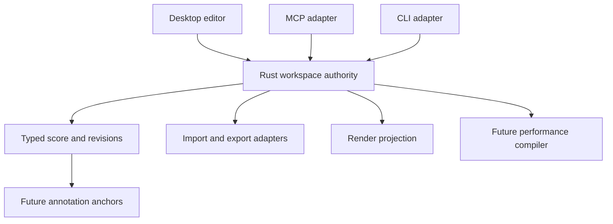

# System Design

**ScoreStream 1.1 proposed design baseline — 2026-11-13**

## 1. Product decision

Build a **Rust score engine shared by a human desktop editor and an agent-facing MCP service**. Use a compact textual format, ScoreStream (`.sfs`), as the editable and model-facing representation. Keep a typed, revisioned score model behind that text. Provide an archival package (`.sfp`) when source preservation, mappings, and assets are needed.

The desktop client contains a notation canvas, text editor, selection and property editing, import/export, validation, and history. An AI can read and modify the same score through MCP, including individual notes and bounded passages. The first useful implementation should prove an end-to-end edit on a modest MusicXML score, render the result, and export a valid MusicXML score before attempting broad notation coverage.

The language is designed to grow without making ordinary music verbose. Basic events remain short; uncommon notation is carried by registered flat records and extensions. An explicit preservation layer retains source material that a particular adapter does not yet interpret. Preservation does not authorize a destructive edit to content whose semantics are unknown.

### 1.1 Scope of this package

This is an implementation-ready design and contract package. It proposes syntax, typed operations, schemas, boundaries, tests, and milestones. It does not deliver the running software. “MUST” in the format and contract chapters describes conformance to this proposal, not an already established external standard.

The initial semantic profile is `core-measured`: a shared rational score-time axis, declared parts and voices, measured events, ordinary written pitch, common state and markings, and identified relationships. Unmeasured graphics, independent temporal clocks, and complete specialized notation vocabularies are explicitly outside this initial interpreted profile. Their sources must be preserved or the import must refuse an unsupported fidelity requirement.

## 2. What the format optimizes

The format serves four related tasks: humans inspecting or editing a passage, language models generating and understanding music, reliable adapters converting notation, and services making precise changes. Those tasks do not have identical needs. One small text syntax cannot replace a typed engine, a source archive, an engraving program, and a performance scheduler.

| Requirement | Design choice | Consequence |
|---|---|---|
| Simple text, little nesting | Line-oriented records with short prefixes | Common music is readable without a JSON tree |
| Simultaneous instruments together | One `@time` frame for all onsets at that score position | Vertical context is visible to the reader and model |
| Exact rhythm | Reduced rational quarter-note units | Tuplets do not accumulate floating-point timing drift |
| Correct notation exchange | Written pitch and written rhythm preserved separately from derived sound | Enharmonic spelling, accidentals, tuplets, and transposition remain distinguishable |
| Safe partial editing | Stable object identity, frozen selection, immutable revision, atomic commands | An agent cannot accidentally apply an old region to a changed score |
| Broad notation scope | Typed core plus versioned feature modules and preserved source attachments | Coverage is explicit and can grow without rewriting ordinary note syntax |
| Human application and agent service | One Rust authority with UI and MCP adapters | Both interfaces have the same behavior and history |
| Future descriptive knowledge | Separate annotation store with revision-aware musical anchors | Analytical prose does not pollute the score stream |

### 2.1 Why spelling remains the authoritative pitch

`C#4` and `Db4` may refer to the same equal-tempered frequency while carrying different musical and written meanings. A numeric key number alone loses that distinction. ScoreStream therefore keeps a pitch as `(diatonic step, exact alteration, octave)`. This matches the distinction represented by MusicXML pitch data, while printed accidentals are separate notation data. [MusicXML pitch](https://www.w3.org/2021/06/musicxml40/musicxml-reference/elements/pitch/) · [Accidental](https://www.w3.org/2021/06/musicxml40/musicxml-reference/elements/accidental/)

Numeric forms are still valuable as **derived views**. A model can request written semitone coordinates, sounding semitone coordinates, intervals, scale degrees with a declared tonal reference, or pitch classes. For a conventional octave numbering, the written semitone coordinate is `12 × (octave + 1) + natural_step_offset + alteration`, with C offset 0. Fractions remain fractions for microtones. The spelling remains available alongside the derived number; a numerical projection must not silently become the reversible master representation.

### 2.2 Why onsets, rather than every sustained sound, are stored

Each event appears at its onset and carries its duration. At time 2, a bass note begun at time 0 may still be active even if its voice has no row at time 2. Reprinting every sustained note at every frame would increase text size, complicate identity, and make partial edits harder.

Offer distinct views named `onsets`, `active_score`, and later `sounding_performance`. The first is the canonical event stream. The second derives intervals covering a score position. The third incorporates repeats, ties, ornaments, transposition, and performance policy. These views answer different musical questions and must never be confused.

## 3. Architecture

The workspace authority owns document identity, revisions, commands, validation, persistence, and jobs. It accepts typed requests from all adapters. Neither MCP nor the GUI writes score tables directly. The renderer is replaceable; it receives a derived notation document and returns layout output plus identity mapping.

The proposed desktop shell is **Tauri 2**. Rust owns the domain, storage, application services, and MCP integration; a TypeScript WebView supplies the editor and SVG interaction. Tauri documents this split between a Rust core process and WebView processes, and offers commands/channels between them. This is a Rust product architecture with a web-based view layer, not a promise of an all-Rust GUI. [Tauri architecture](https://v2.tauri.app/concept/architecture/) · [Process model](https://v2.tauri.app/concept/process-model/) · [Calling Rust](https://v2.tauri.app/develop/calling-rust/)

### 3.1 One authority per workspace

The desktop application embeds the authority. A local stdio MCP executable acts as an IPC bridge to it. A headless mode may run that authority when the desktop is absent, but only after acquiring exclusive workspace ownership. An optional loopback HTTP MCP adapter connects to the same authority.

Do not run two writable caches of the same score merely because one client is a human and the other is an agent. Workspace discovery, owner lifetime, and recovery after a crashed owner are part of the application layer. A process lock alone is insufficient if persistence transactions and crash recovery can still publish inconsistent heads; the storage design must make the commit boundary durable.

### 3.2 Internal domain model

The Rust score model should have typed IDs and explicit types for score time, duration, pitch, staff, voice, measure, state assignment, point mark, and relationship. Event collections are indexed by onset and object identity. Relationships are graph edges with typed endpoints, not anonymous start/stop counters that depend on traversal order.

Flat interchange does not imply flat implementation. A renderer, conversion adapter, selection resolver, or edit validator needs typed musical semantics. JSON is an auxiliary API representation, not the canonical in-memory model. Source token spans and preserved XML are separate attachments to domain objects.

Use exact arbitrary-precision rational arithmetic in the canonical timing layer. A fixed-width fast path is an optimization only when checked overflow can fall back safely. Resource limits remain necessary for adversarial or impractically large numerators, denominators, and least common multiples. Time-to-pixel and time-to-sample conversions occur at explicit boundary layers.

## 4. Documents, packages, and persistence

### 4.1 Plain score text

An `.sfs` file is UTF-8 ScoreStream text. It contains score notation and intrinsic text such as lyrics, directions, titles, and harmony labels. It does not contain a knowledge essay, embeddings, application credentials, renderer output, or audio samples.

For everyday authoring, event IDs may be omitted. A successful import or commit assigns stable internal identities and returns a text-ID mapping. Canonical editor and agent reads include IDs. External opaque API IDs do not have to satisfy the stricter text identifier grammar; adapters map them explicitly.

### 4.2 Archival package

An `.sfp` package is a proposed ZIP-based interchange container. Its manifest references:

- canonical `score.sfs` and its format/profile version;
- immutable original source assets, each with format, media type, hash, and provenance;
- source-to-score identity mappings;
- preserved unsupported payloads, their anchors, and their validity status;
- required notation extensions and any assets needed to interpret them;
- a conversion/fidelity report.

The package must never make an unknown source attachment executable. Paths must be relative and constrained to the package; asset hashes are verified. A final binary package layout and schema should be frozen during the import/export milestone after real fixture requirements are known. The design package delivered here is a ZIP of design materials, **not an `.sfp` score archive**.

### 4.3 Local storage

Use a local transactional store for score metadata, immutable revisions, object/region indexes, change events, and idempotency receipts. Store large original sources, render artifacts, and exports by content hash. SQLite is a reasonable initial implementation choice; logical schema and transactional behavior are more important than that choice.

One commit creates a new revision, stores its operation/result mapping, updates the score head, and persists the idempotency receipt atomically. It then publishes a change event. Undo produces a new revision describing an inverse or restored snapshot; it does not silently move a shared head behind an agent's back. Retention and pruning must respect pinned revisions and archival provenance.

The future analytical knowledge store is physically independent. The score database must open and operate when that store is absent. No foreign key or startup dependency should require an annotation service to be online.

## 5. Interoperability and fidelity

### 5.1 Three different promises

| Promise | Meaning | Test |
|---|---|---|
| Source-byte recovery | The untouched original file can be retrieved exactly | Compare original bytes/hash |
| Musical semantic round-trip | Supported musical properties survive conversion | Compare typed normalized properties and source-to-first-model assertions |
| Engraving equivalence | Relevant layout and glyph decisions survive acceptably | Compare explicit engraving properties and reviewed renderer output |

An untouched source may be recovered from the archive even when the renderer cannot interpret every element. That does not make an edited export semantically lossless. After an edit, preserved payloads affected by the change may become stale. The v1.1 export policies are explicit: `strict` refuses any unsupported required meaning, while `allow_reported_loss` permits a documented lossy projection. Both policies retain only attachments whose validity has been established; the report identifies stale or unsupported attachments. Original-byte recovery is a separate archival function, not a third export fidelity policy.

### 5.2 MusicXML import

Import must understand MusicXML temporal instructions rather than treating XML child order as a global timeline. Resolve each part's measure context, divisions, cursor movement through `backup`/`forward`, simultaneous chord members, voice and staff assignment, and actual event times. Merge resolved onsets across parts into ScoreStream frames. Keep display measure numbers separate from stable measure identity.

MusicXML divisions values are decimal values in the relevant type, not an assumption that every source uses a fixed integer PPQ. Parse finite decimals exactly into rationals. Also preserve written type, dots, time modification, normal type/dots, accidentals, transposition, note visibility, and imported relations. The actual note duration and written notation are distinct source facts; inconsistent source notation should produce a diagnostic rather than a silent “correction.” [MusicXML divisions](https://www.w3.org/2021/06/musicxml40/musicxml-reference/data-types/divisions/) · [Time modification](https://www.w3.org/2021/06/musicxml40/musicxml-reference/elements/time-modification/)

The first adapter milestone should explicitly cover partwise/timewise input, compressed `.mxl` containers, pickup measures, multiple voices, piano staffs, chord ordering, ties/slurs, tuplets, and printed text. Each feature has its own test fixtures and support status. Reading arbitrary XML into a generic blob does not satisfy those semantic gates.

### 5.3 MusicXML export

Export traverses the typed score into legal part/staff/voice serialization, choosing divisions to represent the time rationals exactly when feasible. It inserts required cursor movement and preserves the distinction between sounding ties and printed tied marks. Where a chord structure is not directly legal in the target representation, the exporter must use a documented legal projection, such as explicit voices, or reject the requested fidelity policy.

A denominator strategy for time does not solve every rational representation problem. MusicXML's semitone type is decimal. A ScoreStream alteration of `1/3` semitone cannot be represented exactly as a finite decimal in that field. A target adapter must report this limitation, use a supported target extension if available, or reject strict export. It must not silently round and call the result exact. [MusicXML semitones](https://www.w3.org/2021/06/musicxml40/musicxml-reference/data-types/semitones/)

### 5.4 Required coverage matrix

Maintain a versioned coverage matrix with independent columns for **parse**, **interpret**, **edit**, **export**, **render**, and **perform**. Suggested feature families are:

| Family | Examples to track separately |
|---|---|
| Time and measures | Pickup, additive meter, hidden/irregular measures, tuplets, independent clocks, unmeasured passages |
| Pitch and instruments | Enharmonic spelling, microtones, transposition, octave signs, instrument changes, percussion, tablature |
| Event notation | Rests/spacers, grace/cue notes, noteheads, stems, beams/hooks, tremolos, articulations, ornaments |
| Relationships | Ties, slurs, tuplets, wedges, pedals, lyric extension, cross-staff links |
| Navigation | Repeats, endings, segno/coda, D.C./D.S., fine, playback-only conditions |
| Text and layout | Lyrics, harmony, directions, typography, page/system breaks, staff groups, graphic placement |
| Source extensions | Vendor-specific XML, unknown notation, external glyph/assets |

Core syntax covers common primitives, while extension registries and source attachments cover growth and preservation. Support is not inherited from a neighboring feature: the ability to draw a repeat barline does not prove correct repeat playback.

## 6. Human editing and agent editing

The desktop should present a score list/project view, synchronized SFS editor and notation canvas, properties for selected objects, diagnostics, and history. Source selection highlights the score; clicking a note identifies its stable event and source span. A rectangle is a temporary UI gesture that must be resolved through a revision-specific render map into a musical selection.

Use the same application commands for text commits, pitch/duration edits, note entry, graphical property edits, and MCP operations. The v1.1 region operation preserves the replaced duration and rejects unresolved crossing relationships. Ripple edits, arbitrary measure restructuring, and automatic polyphonic recomposition are later explicit commands, not hidden side effects of replacement.

A dirty text buffer is an uncommitted human draft. If an agent commits while it is dirty, retain that draft and its base revision. The desktop presents the new persisted head and enables reconciliation. Never replace the draft with the agent's version automatically. If the buffer is clean, it may follow the committed head while retaining cursor/selection where IDs still resolve.

### 6.1 Selection and transaction model

The read API resolves a selector against an exact revision and returns a frozen selection, its digest, and boundary context. The edit request names `expected_revision_id`, that frozen selection, typed operations, and an `idempotency_key`. The core validates the full proposed change and commits it atomically using compare-and-swap on the head.

IDs are not enough on their own: a selection of event IDs can still be musically invalid if a tie, tuplet, lyric extension, or sustained note crosses its boundary. Context must include those dependencies. The command may explicitly remove or retarget supported relations, including references to newly inserted fragment events in the same transaction. Unresolved dependencies fail the entire command.

## 7. Preview and later performance

For the desktop prototype, project the score to a renderer-specific representation and use a WebView worker to render SVG. Verovio is the proposed first backend, with a capability and licensing review at implementation time. Preserve score event/measure IDs through the projection and map them to SVG groups. Verovio documents identity mappings and also documents that unsupported MEI content may be discarded during processing; therefore its imported/exported model cannot be the authoritative archive. [Verovio internal structure](https://book.verovio.org/advanced-topics/internal-structure.html) · [Input formats](https://book.verovio.org/toolkit-reference/input-formats.html)

Start with debounced full layout, cancellable or replaceable pending jobs, revision-keyed cache entries, and stale-result rejection. Live desktop preview also covers valid uncommitted text: the editor creates an ephemeral draft snapshot after validation, keyed by session, draft sequence, content hash, and base revision. Invalid text retains the last good view with an out-of-date indicator. This private draft path creates no committed revision and does not change MCP's committed-score reads or its pure edit-diff preview tool.

Incremental parsing, partial score requests, partial SVG delivery, and true incremental engraving are different capabilities. Only the last requires the renderer to preserve global layout correctness after a local edit. Do not promise it before measurement and backend support.

Playback is a future layer. Compile score order into performance occurrences, expand navigation under a bounded policy, construct tempo and expression curves, then map musical time to wall-clock/sample time. Keep written pitch, sounding pitch, MIDI/render events, and audio distinct. MCP can later issue high-level transport commands but must not become the real-time scheduler or audio callback path.

## 8. Future AI generation and knowledge retrieval

A generator should produce bounded candidates in the declared format/profile. Validate lexical structure, references, timing, supported notation, and requested musical constraints before committing. A model's output is a proposed edit, even when it is syntactically valid. Keep model provenance and sampling settings outside the score's musical data unless intentionally authored as score metadata.

For training or retrieval, derive views from the same typed score: onset windows, active vertical harmonies, melodic intervals, harmonic rhythm, instrument/voice roles, and later performance features. Do not create mutually inconsistent authoritative representations for each model. Windows must carry entry state, continuing notes, and crossing relations so a mid-phrase example is interpretable.

Knowledge annotations can describe that a passage increases tension, changes orchestration, or establishes a rhythmic character. Their claims, region anchors, authorship, confidence, and evidence belong to the independent future store. An embedding is a derived index for retrieval, not the canonical annotation text or its identity. Re-embedding must not change the underlying annotation record.

Evaluation should separate syntax validity, musical constraint satisfaction, conversion fidelity, edit locality, and subjective musical quality. When a future training corpus includes variants of the same composition, split at a work/family level to reduce leakage across versions. Source rights and provenance remain corpus metadata; this package includes only original small fixtures.

## 9. Implementation acceptance criteria

The detailed milestones are in the implementation-plan chapter. The first integrated release should demonstrate:

1. A desktop user imports a supported MusicXML fixture, sees SFS and notation, edits a note, and exports the intended result.
2. An agent retrieves the format reference without prior knowledge, reads a passage, replaces it, and receives a revision-bound result.
3. A stale human or agent request conflicts without a partial commit; retrying an identical accepted request does not duplicate it.
4. A render completing for an old revision cannot overwrite the current preview.
5. Unsupported source material remains visible in a coverage report; strict export never silently drops it.
6. An absent annotation database and absent audio engine do not prevent core editing.

Use source-to-first-model golden assertions as well as round-trip tests. If import loses a property and export faithfully reproduces that already-damaged model, a round-trip-only test can miss the loss. Include property tests for rational operations, serialization determinism, identity mappings, edit locality, and transaction invariants where those tests target real failure modes.

Performance targets should be measured on declared fixtures and hardware, with parse, validate, commit, render, and UI latency recorded separately. Numbers in a roadmap are targets, not achieved benchmarks. Freeze product defaults only after representative scores, large orchestral scores, and difficult notation cases have been measured.
