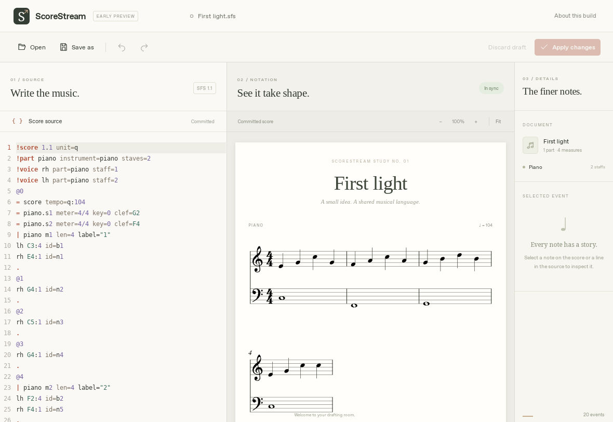
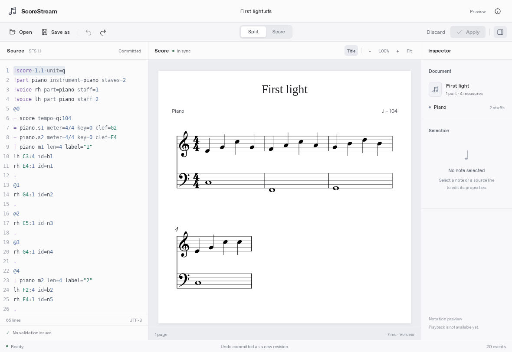
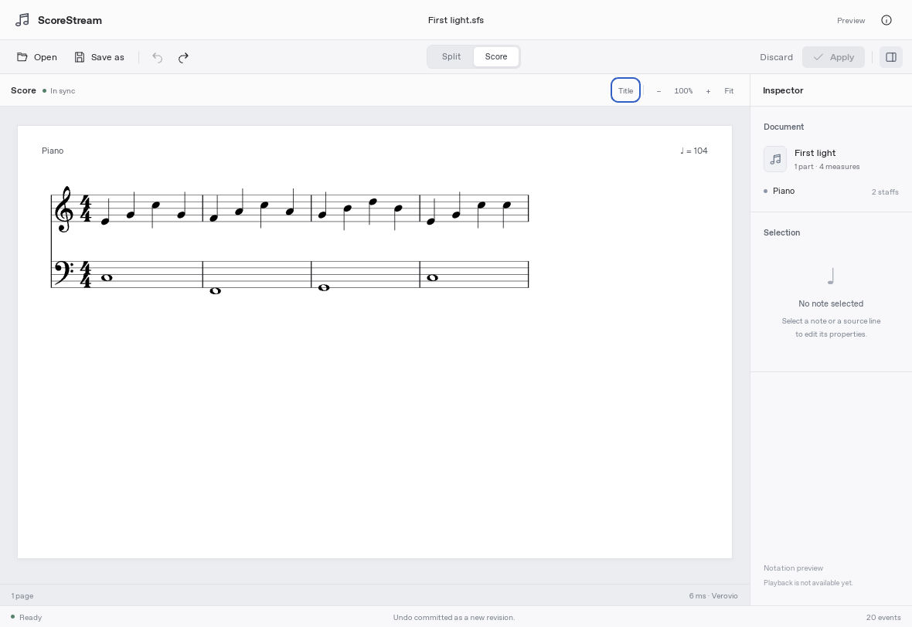

# Desktop UI refinement

This document records the first, natively verified UI pass. The later contextual-inspector/engraving candidate and its separate verification limits are in [Contextual refinement](UI_CONTEXTUAL_REFINEMENT.md). The screenshots below have not been relabelled as the later candidate.

## Intent

The score and source are the work, not a landing page. This refinement follows the user's request for a quieter desktop workspace inspired by Codex App and Apple's desktop design principles. It does not imitate platform branding or claim to be a native AppKit interface.

Design references:

- [Apple HIG: Layout](https://developer.apple.com/design/human-interface-guidelines/layout): clear hierarchy, alignment, progressive disclosure and adaptable panes.
- [Apple HIG: Toolbars](https://developer.apple.com/design/human-interface-guidelines/toolbars): deliberate command selection, functional groups and restrained tinting.
- [Apple HIG: Typography](https://developer.apple.com/design/human-interface-guidelines/typography): legible type and a consistent hierarchy.

## What changed

- Compact system-type toolbars and pane headers replace the three large promotional headings. File commands, view modes and draft actions are separated into predictable groups.
- The default source pane is narrower and the score pane is wider. At the verified 1180 × 812 viewport, the score pane grows from 554 to 628 pixels. The entire application uses a bounded grid, so status/validation bars no longer overlap or fall below the visible editor.
- The synthetic “SCORESTREAM STUDY NO. 01”, tagline and page branding are removed. They were UI-added demo copy, not musical content.
- The existing filename-derived document title remains available, with a Title toggle that only changes its page visibility. The title remains in the document chrome and inspector; instrument and tempo remain above the music. Authored musical markings are not deleted. Existing projection warnings for unsupported markings are unchanged.
- The engraving page-width ratio changes from 2.5 to 2.1, increasing staff size at the same pane width. No score events are filtered or rewritten.
- Split and Score views, a collapsible inspector, and 60–200% zoom provide more space without changing source or revisions. Fit returns to 100%. Zoom compensates for fixed page padding so 200% actually doubles notation dimensions.
- Pane resizing schedules fresh, revision-keyed engraving. Old-width output cannot overwrite newer layouts. A stable scrollbar gutter avoids layout churn when zoom changes overflow.
- View controls have accessible labels and pressed states. Keyboard focus remains visible; reduced-motion preferences are respected. The application retains native file actions, Rust validation, source navigation, private drafts, Apply, typed note edits, and undo/redo.

## Native captures

Before and after, same sample, viewport and zoom:

Optional focused score view, with the filename-derived page title hidden:

The [native smoke report](validation/ui-native-smoke-linux.json) records individual observed assertions.

## Structure

- `desktop/src/shell.ts`: presentation markup and local SVG control icons.
- `desktop/src/style.css`: readable desktop layout, type, colors and responsive rules.
- `desktop/src/layout.ts`: small pure layout/zoom calculations shared by the main view and renderer.
- `desktop/src/main.ts`: existing session orchestration plus presentation-only view controls and debounced layout observation.
- `desktop/tests/layout.test.ts`: five focused tests, alongside the existing eight renderer/scheduler tests.

## Verification on 2026-11-13

Host: Debian 13 x86_64, X11, Tauri 2 / WebKitGTK 2.52.6, using the previously verified local AppDir runtime libraries with a freshly compiled executable. No AppImage was assembled or repackaged for this pass, and no dependency download was performed.

- Frontend tests: **13 passed**.
- TypeScript and production bundle: **passed**. The first unbounded Node build was killed; the retry with `NODE_OPTIONS=--max-old-space-size=512` completed. Expected Monaco/Verovio large-chunk and Verovio Node `module` externalization warnings remain.
- Native normal executable: **built successfully**.
- Native smoke-feature executable: **built and ran**. **34 assertions passed**, including all original editing/preview checks, title preservation, view/inspector round trips, real SVG magnification, horizontal scrollability, zoom settling, dialog dismissal, duration mutation/undo and footer bounds. All 20 demo notes remain rendered.
- Manual native interaction: clicked an actual score note, changed E4 to F4 through the inspector, observed the source/notation change, then used Undo and observed E4 restored. Score focus and title visibility were also checked through actual native controls.
- Genuine before/after screenshots use the same First light demo, 1180 × 812 client viewport and 100% zoom. A separate focused score screenshot shows the optional page title hidden.
- Read-only review found no blocking regression; its scrollbar/zoom concern was addressed and checked by the native smoke assertions.

This is Linux runtime verification, not Windows/macOS acceptance. No new installer or public release was produced. Playback, full notation support, file-picker cancel/overwrite acceptance and a multi-OS release matrix remain outside this pass. The window was visually checked at the recorded viewport; additional window sizes remain a release acceptance task.
